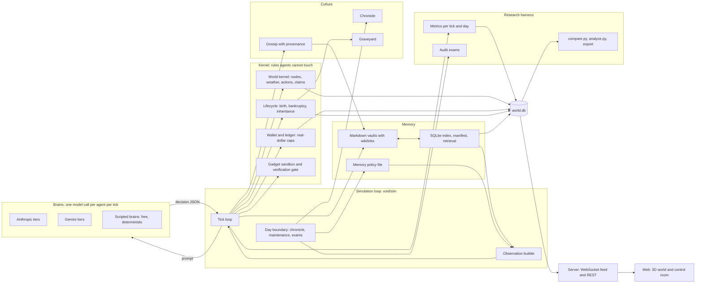
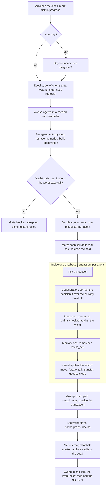
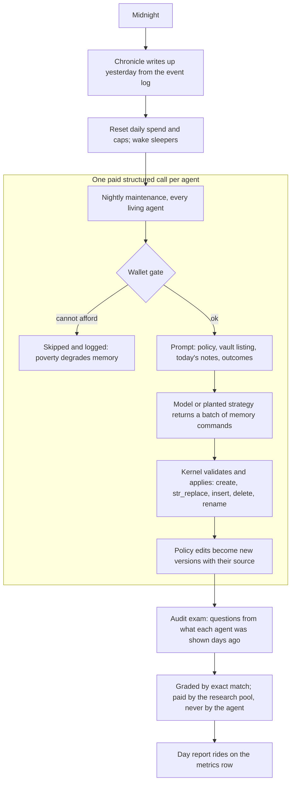
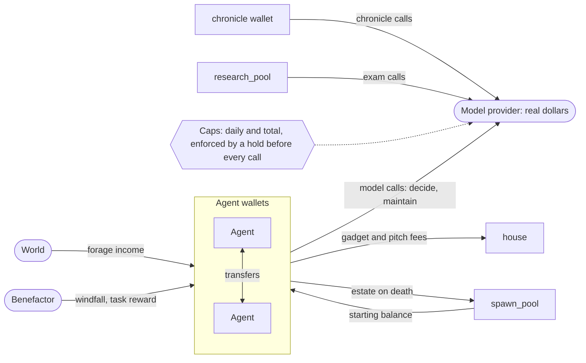
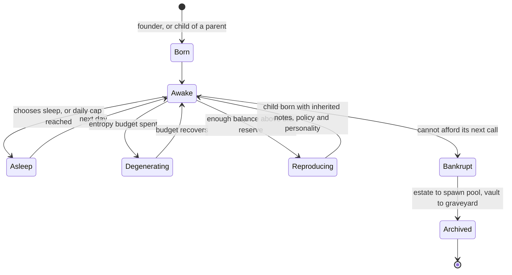
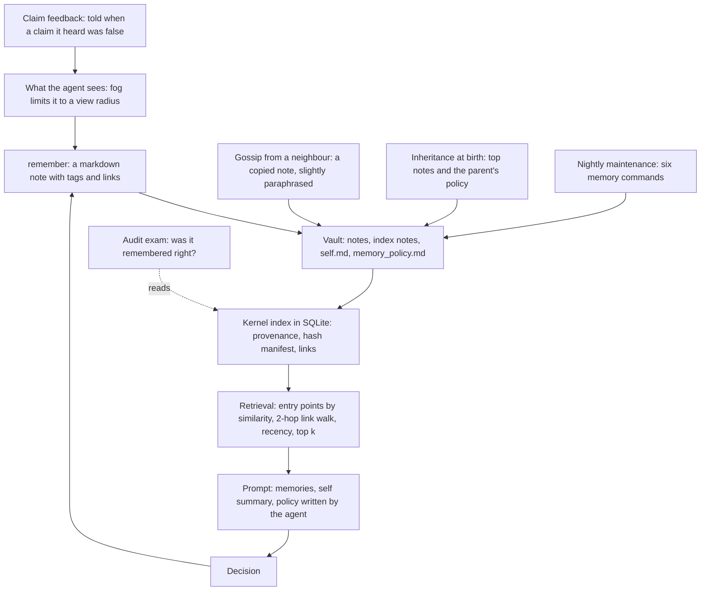
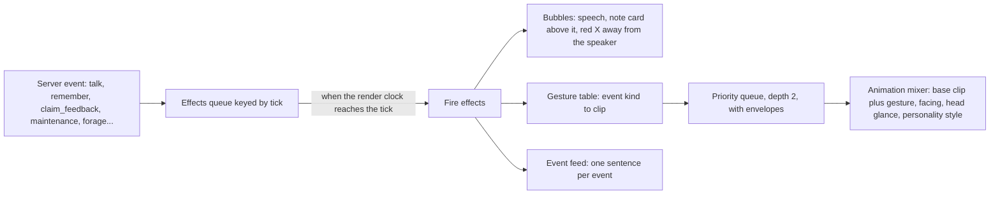
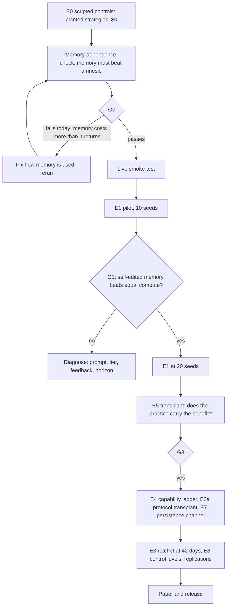
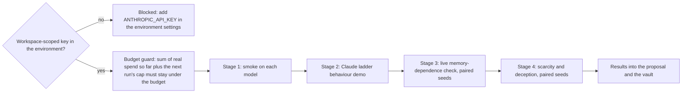

# The Void in diagrams

Flowcharts of how the system works, drawn from the code. They render on GitHub and in Obsidian (Mermaid). PNG renders of each are in [diagrams/](diagrams/), regenerated with `npx @mermaid-js/mermaid-cli` from the blocks below. For the full specification see [DESIGN.md](DESIGN.md); for operations, [RUNBOOK.md](RUNBOOK.md); for the research plan, [research/MEMORY_EVOLUTION.md](research/MEMORY_EVOLUTION.md).

## 1. The whole system

## 2. One tick

## 3. The day boundary

## 4. Money

Every model call is paid from a wallet; the same mechanism is the fictional "no money, you die" rule and the real-dollar safety cutoff.

## 5. An agent's life

## 6. Memory

## 7. Behaviour in the 3D client

## 8. Research plan and gates

## 9. Live Claude test

