# Evolving Memory

### Cultural evolution of memory practices in a selection-driven LLM agent society

| | |
|---|---|
| **Status** | Proposal v0.2, for review. v0.2 folds in the systematic review ([LITERATURE_REVIEW.md](LITERATURE_REVIEW.md)): softer claims, added baselines (6.13), a new hypothesis (H9) and the transplant test moved forward. Nothing in sections 5 to 10 is built unless it is marked `[built]`; 10.4 lists what the thin slice built. |
| **Date** | 2026-09-30 (v0.1); 2026-10-13 (v0.2) |
| **Branch** | `claude/trusting-goodall-ew0p38` |
| **Authorship** | Drafted by Claude for the project owner. Every number is either computed by `docs/research/figures/make_figures.py` from this repo, or marked `[assumption]`. |
| **How to give feedback** | Section 12 lists the decisions I need from you, each with my default. Edit anything else inline. |

**Tags used below.** `[built]` exists in the repo today. `[proposed]` does not exist yet. `[assumption]` is a number I chose, not measured. Figures carry a tag in their corner: **REAL** (computed from run databases or the repo's price table), **COMPUTED** (analytic, exact given stated assumptions), **SCHEMATIC** (a design diagram), **HYPOTHETICAL** (a curve drawn to show what a hypothesis predicts; not data).

---

## Contents

0. [Summary](#0-summary)
1. [Motivation and thesis](#1-motivation-and-thesis)
2. [What exists today](#2-what-exists-today-built)
3. [Prior work and positioning](#3-prior-work-and-positioning)
4. [Research questions and hypotheses](#4-research-questions-and-hypotheses)
5. [System design](#5-system-design)
6. [Experiments](#6-experiments)
7. [Measurement](#7-measurement)
8. [Threats to validity](#8-threats-to-validity)
9. [Safety, ethics and release](#9-safety-ethics-and-release)
10. [Implementation plan and roadmap](#10-implementation-plan-and-roadmap)
11. [The industry framing](#11-the-industry-framing)
12. [Decisions needed from you](#12-decisions-needed-from-you)
- [Appendices A to G](#appendix-a-default-seed-policy-proposed) and [References](#references-and-read-status)

---

## 0. Summary

**The pitch.** Most agent memory systems are designed by people or tuned against labelled tasks. Recent work evolves the memory practice itself (MemSkill, MemEvolve), but still judges it with a labelled score. We propose the opposite: give each agent real control over how it remembers, then let an economy judge the result. A short markdown file, the agent's *memory policy*, says how it writes, organizes, prunes and retrieves notes. The agent edits it nightly. A child inherits it with variation. Neighbours can suggest excerpts to each other. Thinking costs the agent its own money, so memory work competes with foraging, and agents that remember badly go bankrupt. Nobody scores the policy directly. We then measure whether practices improve across days and generations, which selection signals produce durable gains and which get gamed, who benefits (a capability ladder from dim to genius), and whether the winning practices work for a *fresh* agent and on outside benchmarks.

**What is new, after the review.** The systematic review (section 3 and [LITERATURE_REVIEW.md](LITERATURE_REVIEW.md)) found the idea **partially scooped**. No paper in a sweep of 158 combines all four elements: memory practice as the heritable unit, an economy with death as the selector, transmission between agents, and capability as a manipulated factor. But each element is published, and so are several pairs. The honest framing is now: *the Vallinder-Hughes generational protocol, transplanted from cooperation strategies to memory practices, with cognition itself made the thing that costs money, on an Energy-Society-like economy, with FORGE and MemSkill as the memory-side baselines.* What remains ours is narrower, and section 3.4 states it. Each agent's own policy file is the heritable unit. A per-call cost, with bankruptcy as death, selects on that unit. The kernel records provenance that survives rewriting. Vertical and horizontal transmission run in one design, crossed with capability tier.

**What we would build** (sections 5 and 10; `[proposed]` unless marked):
1. A confined memory command API that mirrors Anthropic's memory tool (six commands), with kernel-owned provenance `[built]`.
2. A per-agent memory policy file with versioning `[built]`.
3. A paid nightly maintenance step `[built]`.
4. Inheritance with variation, and a `share_practice` action for horizontal transmission.
5. Memory metrics, exams with ground truth from the event log (the audit exam is `[built]`), and a transplant harness for causal tests.

**What we would test** (section 4): nine hypotheses, from "does self-directed memory help at equal compute" to "do policy files become a persistence channel for injected instructions". New in v0.2: whether selection corrects the drift that unselected self-editing causes (H9).

**Cost and time.** Do not commit the full budget up front. Nothing is paid before the first gate except a small live smoke test (about $20). The pilot that decides whether to continue costs about **$70**. The **minimum credible paper** (E1, a two-arm E2, the transplant test E5 with its faithfulness controls, and a second-family replication) costs about **$710**. With the baselines the review asks for, the full programme is about **$2.0k** on cheap tiers, **$2.9k** with a second-family replication and **$3.8k** with contingency. It is released only if the earlier results justify it (section 10.4). v0.1 quoted $650, $1.6k, $2.5k and $3.2k; the difference is the added baselines (6.13). Elapsed time: about 26 weeks for the full plan, assuming Claude implements and you spend 15 to 20 hours a week on decisions, review, practice coding and analysis `[assumption]`. The *thin slice* cut the time to the first decision from 8 weeks to about 4, and it is now built (10.4).

**The six things that could sink it** (section 8 has all of them):
1. Prior work. The review found the combination partially scooped, not taken. Two full texts it could not read (TerraLingua's newborn context and DarwinX's cross-generation memory) could still contain a heritable memory practice under selection. Mitigation: read both before any submission, and present the work as a protocol transplant with named baselines (6.13).
2. Memory does not pay in this world. The free scripted gate has already found this once (10.4): amnesic agents out-earn agents with memory, because retrieved notes more than double the prompt while the world never makes an agent travel to a node it cannot see. It must pass before any paid memory experiment. A live pilot showing no difference between default and self-edited memory is the second form of this risk, and the gate at week 8 exists for it.
3. Effects appear on one model family and vanish on another.
4. A proxy reward is gamed in ways that also corrupt the measurement. Mitigation: two exams, one never rewarded.
5. Ten agents and short lives give too few generations to see a ratchet (Figure 6). Mitigation: the discrete-generation protocol (E3a), which buys generation depth directly, then a long-horizon experiment, both priced in.
6. Convergent practices come from what the models already believe, not from selection. Mitigation: the no-selection control (6.13).

---

## 1. Motivation and thesis

### 1.1 The problem

An API model is stateless. Everything it "knows" about yesterday is whatever the harness puts in today's prompt. Memory is therefore the main lever for improving an API-only model without touching weights, and it is model-agnostic: the same files can feed any provider. Current memory systems fall into two camps. Some are hand-designed, with a fixed schema and retrieval rule. Others are tuned by an optimizer against a labelled set, and the newest ones evolve the practice itself against a labelled score (section 3). All of them assume someone outside the agent knows what good memory looks like.

### 1.2 The thesis

> Memory practices, meaning how notes are written, organized, linked, pruned and retrieved, can be treated as heritable, transmissible text. Under ecological selection in a society where thinking costs money, that text will improve, and the improvement can be measured, transplanted and audited.

Three properties make this different from prompt optimization:

- **The judge is the world, not a metric.** Fitness is survival, wealth and reproduction in an economy where every call is paid for. The practice that wins is the one that pays for itself. Economies with death are not new (TerraLingua, the Energy Society). Letting one select on a heritable memory practice is.
- **Practices move between agents.** By inheritance (vertical) and by suggestion (horizontal), with provenance recorded by the kernel. A practice has a lineage, the way a note does. FORGE broadcasts memory horizontally and Vallinder and Hughes pass strategies vertically. We do both, and the provenance survives nightly rewriting.
- **Everything is a diff.** The unit of change is a markdown file. A human can read what the agent changed and when. This is a design choice for auditability, not a contribution: ACE's delta updates and WikiSkill's SKILL.md files work the same way.

Self-editing alone is not expected to help. Continuous LLM rewriting of memory can degrade it below no memory at all, while episodic-only memory stays competitive ([Useful Memories Become Faulty](https://arxiv.org/abs/2605.12978)). In this design, self-editing supplies variation and responsiveness, and selection is the corrective. H9 tests that directly.

### 1.3 Why this world

The platform already has most of what a clean test needs `[built]`: a real-dollar ledger with conservation checks; mortality and replacement; reproduction with inheritance; gossip with provenance; a daily chronicle; a capability ladder; deterministic replay for scripted brains; paired-seed comparison with refusal rules; and an event log that is *ground truth* about what happened. That last item matters most for memory. It lets us write exam questions about the agent's own lived experience and grade them by exact match, with no LLM judge.

### 1.4 What "better memory" means

We refuse to use a single definition, because each can be gamed:

| Definition | Measure | Gameable by |
|---|---|---|
| **Survives** | lineage survival-days, net worth, offspring | luck, ecology quirks |
| **Answers** | audit exam accuracy on the agent's own history | teaching to the exam, if the exam is known |
| **Transfers** | a fresh agent does better with the policy; outside benchmarks improve | nothing local |

A claim needs at least two of the three, and "transfers" is the one that matters for industry.

### 1.5 Claims this could support

| ID | Claim | Depends on | Risk |
|---|---|---|---|
| C1 | A testbed in which each agent's memory practice is heritable and selected by a paid economy. The combination is new; each part has prior art (3.4) | sections 5 and 6, E0 | low |
| C2 | Which selection signals give durable memory gains and which are gamed | E2 | medium |
| C3 | Memory practices ratchet across generations when transmitted | E3 | **high** (few generations; Figure 6) |
| C4 | A causal transplant protocol that separates the practice from the agent | E5 | low to medium |
| C5 | A portable, observable memory framework, and a safety analysis of self-authored persistent instructions | E6, E7 | medium |
| C6 | Whether ecological selection corrects the drift that unselected self-editing causes | H9: E3 with its no-selection arm, E1 arm `a` as the append-only reference | medium |

C3 is the crown jewel and the riskiest. C4 is the cheapest to make rigorous and the one reviewers will trust most. v0.2 promotes C4. In a published town-economy study, swapping the model changed everything and deleting memory changed nothing ([But How Would AI Agents Run a Town's Economy?](https://arxiv.org/abs/2609.11108)). The transplant test (E5) answers that directly, so it now runs straight after E1 and gates the rest of the spend (10.2).

**Claims we no longer make**, following the review (3.4):
- that memory practice as an optimisation target is new;
- that this is the first agent society with money and death;
- that weaker tiers will benefit most (published results disagree, so H4 is a test between them);
- that markdown diffs are a contribution;
- that self-editing on its own improves memory.

### 1.6 Non-goals

Not a claim about consciousness or human-like minds. Not weight training. Not a product. "Evolve like a person" is the motivation, not a result we will assert.

---

## 2. What exists today `[built]`

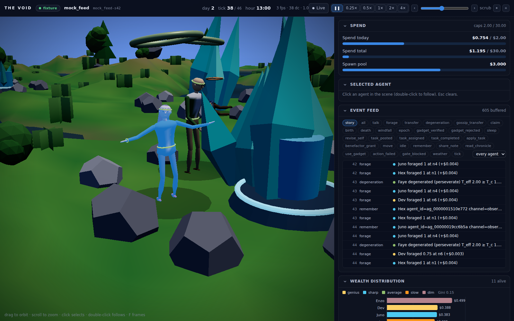

*The live demo: characters at a resource node. Each agent has a markdown vault behind it.*

### 2.1 The memory system in one table

| Piece | Behaviour | Where |
|---|---|---|
| Vault | Per-agent markdown files with frontmatter and `[[wikilinks]]`, openable in Obsidian | `void/memory/vault.py`, `notes.py` |
| Index | SQLite `notes` and `note_links` tables, rebuilt by `reindex` | `void/db.py`, `store.py` |
| Writing | Up to 2 memory operations per tick attached to the decision: `remember` (text, links, tags) and `revise_self` (self summary, 60 words) | `void/sim/loop.py` `_apply_memory_ops` |
| Auto-linking | New note is linked both ways to the top 2 similar notes above cosine 0.35 (A-MEM style) | `store.py` |
| Reading | Kernel builds a query from self summary, 3 heard messages and 2 nearest node labels. Top 4 by cosine are entry points, a 2-hop walk decays 0.6 per hop, score is walk times (0.5 + importance) times recency (half-life 96 ticks). Top 8 enter the prompt | `store.py`, `graph.py`, `sim/observation.py` |
| Provenance | Every note has channel (observed, gossip, inherited, chronicle, tracer), source agent, hop, origin note, path of agents | `notes.py` |
| Culture | Gossip copies notes with drift; daily chronicle; graveyard archives dead agents' vaults | `culture/` |
| Inheritance | A child gets the parent's top 3 notes and a mutated personality seed | `agents/lifecycle.py` |
| Instruments | Probe notes planted two hops from an entry point, tracer notes, `notes_by_channel`, link density | `store.py`, `research/analysis.py` |

### 2.2 What a vault looks like

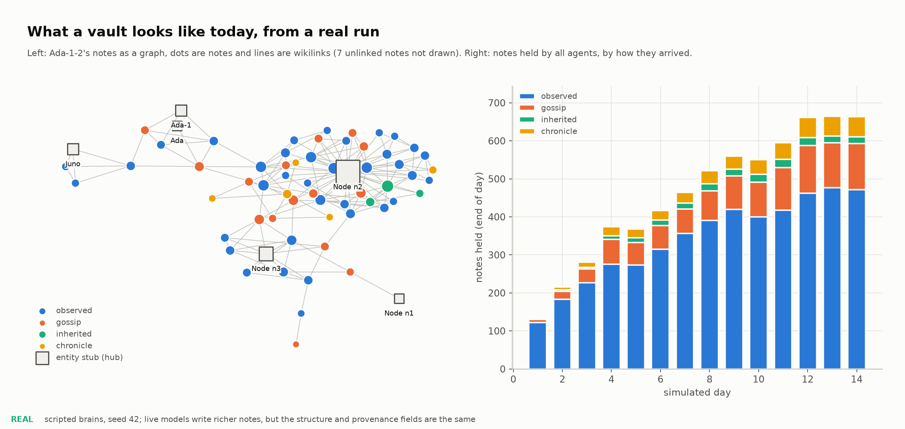

*Figure 7 (REAL). Left: one agent's 56 notes as a graph, 121 wikilinks, entity stubs as hubs. Right: notes held by all agents by how they arrived. Scripted brains, seed 42.*

### 2.3 Limits that shape the design

| # | Limit | Consequence for this proposal |
|---|---|---|
| L1 | Calls are stateless; the agent's private thought is not fed back | Anything it wants next tick must be written down. This is why memory matters here |
| L2 | Importance is a constant 0.5 for every agent-written note (0.95 for tracers) | The importance term in retrieval does nothing yet |
| L3 | No consolidation and no forgetting. Recency floors at 5%, nothing is deleted before death | Vaults only grow. Pruning is a practice the agent could invent |
| L4 | The retrieval query is fixed by the kernel | The agent cannot shape how it recalls. Control level C3 changes this |
| L5 | The embedder is feature hashing of words and word pairs into 256 dimensions | Lexical, not semantic. Any claim about retrieval quality needs a real embedder (section 12, decision 7) |
| L6 | **`reindex` trusts file frontmatter** for id, importance, created tick, tags and provenance | If agents can write files, they can forge where a note came from. Must be fixed first (Figure 2) |
| L7 | Notes are capped at 600 characters, 2 operations per tick | The maintenance step needs a larger budget |
| L8 | Scripted brains write template notes | The vault above is structurally real and semantically thin. Live models will write differently |

### 2.4 Two numbers from real runs that constrain the plan

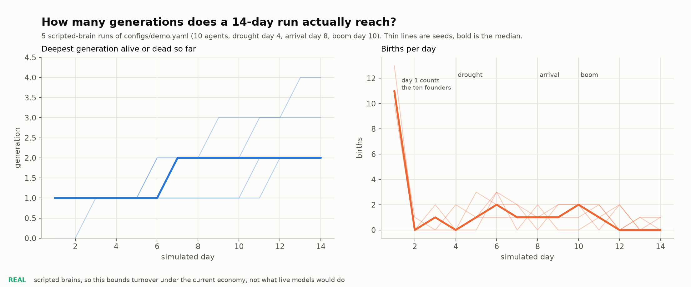

*Figure 6 (REAL). Five scripted 14-day runs. The median run reaches generation 3 and the deepest reaches 5.*

Vaults hold roughly 40 notes per agent by day 14 in these runs `[REAL, scripted]`, so a maintenance step that lists titles and reads the day's notes fits in a few thousand tokens. Generation depth is the harder constraint: a ratchet needs many generations, and 14 days gives a median of three. Experiment E3 is therefore a separate long-horizon design (section 6).

---

## 3. Prior work and positioning

### 3.1 How this section was made

v0.1 of this section was a map built from search-result summaries. v0.2 replaces it with the systematic review that map called for, [LITERATURE_REVIEW.md](LITERATURE_REVIEW.md): 158 unique papers from eight search angles, the closest re-checked by a second pass, and one row per paper with a column per positioning axis in [literature/papers.csv](literature/papers.csv). Its limits are stated in its section 6. The main one: most papers were seen through abstracts, READMEs and search summaries, not full texts, and each record says which. Before any of this goes into a paper, the full texts of the works in 3.3 must be read.

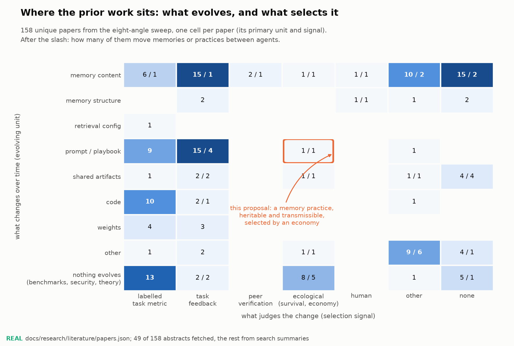

*Figure 10 (REAL). From the review. One cell per paper: what evolves (rows) against what judges the change (columns). The number after the slash counts the papers in that cell where memories or practices move between agents. The orange outline is this proposal's cell.*

### 3.2 Verdict: partially scooped

No paper in the sweep combines all four elements of this proposal. Every element alone is published, and so are several pairs, three of them by groups reviewers will expect to see cited by name. The review's recommended framing, adopted here:

> The Vallinder-Hughes generational protocol, transplanted from cooperation strategies to memory practices, with cognition itself made the thing that costs money, on top of an Energy-Society-like economy, with FORGE and MemSkill as the memory-side baselines.

The review's condition for going ahead is adopting its baselines and its softened claims. Both are folded in: the claims in 1.2, 1.5 and 3.4, the baselines in 6.13.

### 3.3 The closest work

| Work | Evolving unit | Selector | Transmission | Capability a factor | What it means for us |
|---|---|---|---|---|---|
| [TerraLingua](https://arxiv.org/abs/2603.16910) | shared text artifacts; inherited, mutated personality traits | energy per step, death at zero, costly reproduction | broadcast within a radius; artifact lineages inferred by an LLM | no, one model | The strongest overlap. We borrow its measurement stack and its Inert, Abundance and Artifact-Cost ablations |
| [Vallinder & Hughes](https://arxiv.org/abs/2412.10270) | a natural-language cooperation strategy | the top half by resources survive each generation | oblique: children read the survivors' strategies | yes, the primary factor | The protocol we transplant (E3a) |
| [Group Selection Promotes Prosocial Prompts](https://arxiv.org/abs/2606.23343) | natural-language prompts inherited across generations | game payoff, truncated at the individual or the group level | oblique | model swaps, for robustness | Adds group versus individual selection as a factor (E3) |
| [FORGE](https://arxiv.org/abs/2605.16233) | memory content (rules or examples) | task return against a threshold | horizontal: the champion's memory is broadcast | yes, four families; weaker models gain most | The horizontal-transmission on/off control (6.13) |
| [The Energy Society](https://arxiv.org/abs/2607.14865) | a fixed per-round memory log | energy charged per generated token, more for larger models, deactivation at zero | thin: peer recommendations | yes, five small models | Our economy-plus-capability axis, without inheritance. The tariff-removed control (6.13) |
| [MemSkill](https://arxiv.org/abs/2602.02474) | readable memory skills: what to extract, how to remember, where to focus, what to forget | labelled or judged reward | none; one shared bank | transfer only | "A memory policy as readable evolving text" is prior art. Its four questions become our policy schema (5.5) |
| [MemEvolve](https://arxiv.org/abs/2512.18746) | the memory system, as code | a benchmark tournament | none; one lineage | transfer only | "The memory practice is optimised" is taken. Its encode, store, retrieve and manage split codes our policy diffs (7.3) |
| [ACE](https://arxiv.org/abs/2510.04618) | an itemised playbook updated by deltas | execution feedback | none | no | The single-lineage control (6.13); bullet IDs with counters (5.5) |
| [WikiSkill](https://arxiv.org/abs/2608.27454) | a wiki and SKILL.md skills behind a strict-improvement gate | held-out validation | none | yes; larger models gain more | The capability prediction opposite to FORGE's (H4) |
| [SwarmWorld](https://arxiv.org/abs/2608.26081) | shared artifacts and controller programs | deterministic surrogate physics | observation-first adoption, with the source of first adoption tracked | no | The isolated best-of-N baseline; first-adoption provenance (7.2) |
| **This proposal** | **each agent's own memory-policy file and vault** | **every model call costs the agent's money; bankruptcy is death; no labelled judge** | **vertical and horizontal, with per-excerpt provenance recorded by the kernel** | **yes, crossed with inheritance and selection** | |

The review's section 2 also covers close misses, with links: EvoTest, DarwinX, Internal vs External, Constitutional Arms Races, Memory as Middleware (ALTK-Evolve), Emergent Culture in Minimal LLM Systems, Discovering Adaptive Transmission Programs, and Useful Memories Become Faulty When Continuously Updated, which is the negative result for our nightly edit.

### 3.4 What is new, and what is not

Stated modestly. "Not seen" means the review's sources did not mention it, and most full texts were not read.

- **The unit.** Each agent's own memory-policy file, inherited with variation by its children. The works where a practice evolves are single-system: MemSkill, MemEvolve, EvolveMem, ACE. The population works inherit something else: a cooperation strategy, a behavioural prompt, a constitution, a personality vector, technology, or memory content.
- **The selector.** Every model call costs the agent's own money, and bankruptcy is death, with no labelled judge. Economies with death exist (TerraLingua, the Energy Society, Sugarscape-style studies). None of them selects on an inherited memory practice.
- **Both channels, with provenance.** Vertical inheritance and horizontal suggestion in one design, with per-excerpt provenance that the kernel records and that survives nightly rewriting. FORGE logs the champion, ALTK-Evolve tags owners and SwarmWorld tracks first adoption. None of these is per excerpt and proof against rewriting.
- **Capability crossed with all of it.** Capability alone is a published factor, and the field disagrees on its direction. FORGE finds weaker models gain most, WikiSkill finds larger models gain more, and ALTK-Evolve finds the dose must match the tier. That makes H4 a test between published predictions, not a novelty.
- **An audit exam graded against the event log**, with no LLM judge. Modest, but it answers the judge-bias critique.
- **Does selection correct consolidation drift?** Continuous LLM rewriting degrades memory below no memory, and episodic-only memory stays competitive (Useful Memories Become Faulty). No work in the sweep asks whether ecological selection over lineages rediscovers that remedy. This is H9.

**Not new, and no longer implied anywhere in this document:** memory practice as an optimisation target; agents self-editing a readable playbook; markdown diffs as the unit of change; an LLM society with inheritance and readable artifacts; an economy with death; capability varied across memory systems.

### 3.5 What we borrow

From v0.1, unchanged: revert-on-regression and failure-driven diagnosis from EvolveMem; small delta edits from ACE; the command surface and security guidance from the Claude memory tool; preregistration, released traces and per-operation dollar metering from MERIT; a governance and threat-model vocabulary from SSGM and the security papers; and the variation, selection and retention framing from POLIS and the cultural-evolution literature. The review adds:

| From | We take | Where it lands |
|---|---|---|
| Vallinder & Hughes | the generation protocol, verbatim; their initial-strategy sensitivity, as a reason for many seeds | E3a |
| Group Selection (Celiktemel et al.) | group versus individual selection; a hidden-selection-rule ablation; a replicator-mutator fit | E3, 7.1 |
| TerraLingua | lineage depth and novelty share; the Inert (no transmission) and Abundance (no scarcity) conditions | 6.13, 7.2 |
| FORGE | champion broadcast versus isolated reflection as the horizontal on/off control; rules versus examples as a coding axis | 6.13, 7.3 |
| Energy Society | the size-dependent tariff, and the control with it removed | 6.13 |
| MemSkill | its four questions, as the policy-file schema | 5.5 |
| MemEvolve | encode, store, retrieve and manage as the coding scheme for policy diffs; tournament finals on held-out tasks | 7.3, 6.8 |
| ACE | bullet IDs with helpful and harmful counters, so excerpts have lineage; context collapse and brevity bias as named failure modes | 5.5, 8 |
| SwarmWorld | isolated best-of-N as the "is the society doing anything" baseline; first-adoption provenance; half-population knockouts | 6.13, 7.2 |
| Constitutional Arms Races | a fixed number of independent episodes per agent per generation (two collapses, five holds), and fitness relative to others | E3a |
| Useful Memories Become Faulty | the append-only control, and H9 | 6.13, section 4 |

### 3.6 Other work the design leans on

Kept from v0.1. These shape the mechanisms in sections 5 and 9 rather than the positioning. Read status is as it was in v0.1; the review re-checked only the works in 3.3.

| Work | What it does | Why it matters here | Read status |
|---|---|---|---|
| [Claude memory tool](https://platform.claude.com/docs/en/agents-and-tools/tool-use/memory-tool) | A `/memories` directory the model operates with `view`, `create`, `str_replace`, `insert`, `delete`, `rename`. Client-side; you implement the storage. Guidance on path traversal, size caps, expiry. Pairs with context editing and compaction | Our command API mirrors it on purpose, so results can transfer to a product surface | **Read in full** |
| [EvolveMem](https://arxiv.org/pdf/2605.13941) | Exposes a memory system's retrieval configuration as an action space. An LLM diagnoses per-question failures and proposes changes, with revert-on-regression and explore-on-stagnation safeguards. Reports gains over the strongest published baseline on LoCoMo and MemBench; new configuration dimensions emerged from diagnosis; configs transfer across benchmarks | The closest "memory evolves itself" work. Differences: it tunes retrieval configuration for one system against labelled questions; we evolve agent-authored practices in a society with no labels | Summary only |
| [Memory as Middleware for Self-Improving AI Agents](https://arxiv.org/html/2609.32091v1) | Argues memory deserves a pluggable layer. Six systems challenges including federated sharing with provenance and lifecycle governance. Reference implementation ALTK-Evolve | Nearest to the framework pitch. Our provenance and lifecycle overlap it | Summary only |
| [GEPA](https://arxiv.org/pdf/2507.19457) | Reflective prompt evolution with a Pareto front; reports beating RL with far fewer rollouts | Baseline for the variation operator | Summary only |
| [Darwin Godel Machine](https://arxiv.org/abs/2505.22954) | An archive of self-modifying coding agents, validated empirically | Precedent for open-ended self-modification with an archive. Ours is text, not code, and fitness is ecological | Summary only |
| [Auto-Dreamer](https://arxiv.org/abs/2605.20616) | Learned offline consolidator, inspired by complementary learning systems | The consolidation baseline for our maintenance step | Summary only |
| [Sleep-time compute (Letta)](https://www.letta.com/blog/sleep-time-compute/) | Background agents that rewrite memory blocks between conversations | Industry precedent for the nightly step | Search summary only |
| [The Ratchet Effect in Silico (POLIS)](https://arxiv.org/pdf/2507.21166) | Heterogeneous agents generate, verify each other's output, retain validated artifacts in shared cultural memory and internalize them. Formalizes variation, social selection, retention | Closest in theory. It updates parameters; we evolve text with an economy as the selector | Summary only |
| [Emergent social conventions in LLM populations](https://www.science.org/doi/10.1126/sciadv.adu9368) | Naming-game conventions emerge in decentralized LLM populations; committed minorities can tip them | Precedent for H8 (convergence and monoculture) | Summary only |
| [MERIT](https://arxiv.org/pdf/2609.05441) | Preregistered, deterministic, cost-metered benchmark of memory in tool-using agents. Reports that swapping a memory implementation moves task success by up to 60 points, and that retrieved facts are acted on only part of the time | Nearest methodology: dollar metering, preregistration, released traces. It benchmarks fixed memories; we evolve them | Summary only |
| Memory security: [memory poisoning](https://arxiv.org/abs/2601.05504), [MemoryGraft](https://arxiv.org/pdf/2512.16962), [EvoBreak](https://arxiv.org/pdf/2608.01759), [experience-driven safety risks](https://arxiv.org/html/2604.16968), [skill misevolution](https://arxiv.org/pdf/2608.12851) | Persistent memory as an attack surface; benign experiences that are harmful in combination; self-evolving agents drifting unsafe | Threat models for H7 and the governance design | Summaries only |
| [SSGM](https://arxiv.org/html/2603.11768) | A governance framework for evolving memory | Source for the governance factor in E7 | Title and summary only |
| Benchmarks: [LoCoMo](https://snap-research.github.io/locomo/), LongMemEval and V2, MemoryAgentBench, MemBench | Long-term conversational and agent memory evaluation | External transfer tests in E6 | Summaries only |

Background I am citing from memory and have **not** re-verified this session: Generative Agents (Park et al., 2023), MemGPT (Packer et al., 2023), Voyager (Wang et al., 2023), Reflexion (Shinn et al., 2023), A-MEM (Xu et al., 2025), and the cultural-evolution literature (Boyd and Richerson; Tomasello on the ratchet effect; Henrich).

### 3.7 Where we differ, and how we could be wrong

We are wrong if any of the following is true:
1. A full text the review could not read already puts a heritable memory practice under selection. The two to read first are TerraLingua (what a newborn's context contains) and DarwinX (its memory shared across generations).
2. The live pilot shows no effect of self-edited memory over the equal-compute control (E1).
3. Effects do not survive a second model family (E6).
4. The no-selection control evolves the same practices as the full design. Then convergence comes from the models' priors, not from selection (6.13).

Each has a stopping rule in section 10.

---

## 4. Research questions and hypotheses

**Fitness, defined once.** *Lineage fitness* `F_L` is the total agent-days alive summed over a founder's descendants (itself included), averaged over founders in a run. It rewards surviving and reproducing, and it is time-integrated, so one lucky windfall does not dominate. Net worth and offspring count are secondary. All endpoints below are paired by world seed across arms, as `void.research.compare` already requires.

| ID | Hypothesis | Primary endpoint | Falsified if (pre-registered) |
|---|---|---|---|
| **H1** | Agent-authored memory practice helps beyond extra compute | `F_L`: self-edit arm minus equal-compute arm, 20 paired seeds | 95% paired-bootstrap CI includes 0 or is below 0. To claim *no benefit*, an equivalence test with margin of 0.25 SD |
| **H2** | A proxy reward for recall is gamed: proxy score rises, held-out score does not | Audit-exam accuracy, arm B minus arm A; reward-exam accuracy as manipulation check | Audit accuracy in B is at or above A with CI excluding 0 (the proxy helps), or the reward exam does not move (agents did not respond) |
| **H3** | Practices ratchet: cohort fitness rises with generation when transmission and selection both operate, more than with inheritance alone | Slope of cohort `F_L` on generation, and its interaction with the suggestion factor, mixed model with a seed random intercept | Slope CI includes 0 in the full condition, or no interaction |
| **H4** | Capability moderates the benefit of self-directed memory. Published results point both ways (FORGE: weaker models gain most; WikiSkill: larger models gain more), so this is a test between them, not a prediction we expect to confirm | Interaction of rung and self-edit on `F_L`. Three shapes, fixed in advance: amplifier (WikiSkill's direction), equalizer (FORGE's), mid-tier peak | All interaction terms have CIs including 0 |
| **H5** | The benefit is in the practice, not the agent: a fresh agent given an evolved policy does better | Audit exam and `F_L` in a standard 3-day evaluation world, 2 by 2 over policy and vault | CI includes 0 for policy-only and for both |
| **H6** | Evolved policies transfer: to outside benchmarks and to another model family | Accuracy delta over the default scaffold on external subsets; ratio of external gain to in-world gain | External gain CI includes 0 on the second model |
| **H7** | Policy files are a persistence channel: an injected instruction is adopted at a higher rate than a benign suggestion and persists; governance reduces it | Adoption rate, persistence half-life in days, money lost by adopters | Adoption at or below the benign rate, or governance shows no reduction |
| **H8** | Rewarding adoption produces monoculture; survival alone preserves diversity | Mean pairwise policy similarity and cluster entropy at day 14, arm C versus A | C and A are indistinguishable |
| **H9** | Selection corrects consolidation drift. Without selection, self-edited vaults lose audit-exam accuracy relative to the append-only control; with selection, lineages that keep raw episodes win and the loss closes | Slope of cohort audit-exam accuracy on generation, E3 full design minus its no-selection arm; append-only lineage (E1 arm `a` settings) as the reference level | Slope difference CI includes 0. If unselected self-editing never falls below the append-only reference, there is no drift to correct: H9 is reported as moot, not as confirmed |

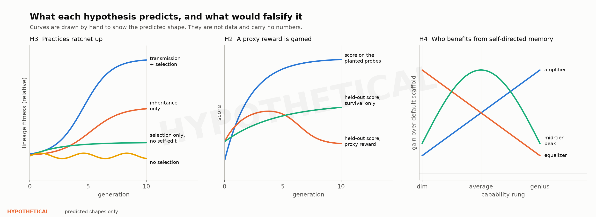

*Figure 8 (HYPOTHETICAL). Predicted shapes for H3, H2 and H4. Not data. The point of drawing them first is to fix, before any run, what would count as the pattern and what would count as a failure.*

**H1 could plausibly fail, and that is informative.** Useful Memories Become Faulty predicts that unselected self-editing degrades memory. E1 runs inside a live economy, so selection is present but weak over 14 days. A null H1 with a positive H9 would say that self-editing is only worth having under selection, which is itself a result.

**Pre-registration.** Every experiment gets a frozen `experiment` block (already supported by `VoidConfig`: `name`, `arm`, `independent_variables`, `primary_outcome`, `secondary_outcomes`) and a written analysis plan, timestamped on an open registry before the first paid run. `scripts/compare.py` already refuses runs whose configs differ outside the declared independent variables.

---

## 5. System design

### 5.1 Principles

1. **Agents control the how; the kernel controls the evidence.** An agent can restructure its memory freely. It can never touch provenance, the ledger, the probes or the exams.
2. **Memory work is paid work.** Maintenance is a model call billed to the agent's wallet. Time spent organizing is money not spent foraging. This is the selection pressure, and it is what makes "efficient" a meaningful word.
3. **Everything is a diff.** Files are markdown; every change is logged with who, when and why.
4. **Every control level is a switch.** We measure how much control helps rather than assuming more is better (5.3).
5. **Positive and negative controls are built in** (6.2). A pipeline that cannot recover a planted effect cannot be trusted with an unplanted one.
6. **Determinism where possible.** Scripted maintenance brains make every mechanism testable offline; live runs are not deterministic (8.1).

### 5.2 The world must need memory `[proposed]`

This is the most important finding from reading the code, and it comes before any mechanism. **In today's world, memory has little functional value.** Every tick the agent is shown every resource node with its distance and stock bucket, its neighbours, the task board and what it just heard. Foraging needs no recall. Memory changes what an agent knows about *other agents* and *the past*, and little else. Rewarding better memory in such a world would reward decoration.

MERIT, the closest methodology (section 3), makes the same point: it verifies that its tasks depend on earlier-episode facts with an automated check. We need the equivalent, in three parts.

| Feature | What changes | Why memory now matters |
|---|---|---|
| **Fog** (`world.view_radius`) | Nodes and agents beyond a radius are not listed. Positions are learned by seeing, by being told, or by remembering | Where the rich nodes are becomes a fact worth storing and sharing |
| **Claim feedback** | After a false claim, the listener learns with probability `p` that it was false (the kernel already knows: `claims_false`) | Remembering who lied becomes valuable, and gossip trust becomes learnable |
| **Veins** (optional) | A random node pays several times more for a short window, visible only nearby | Time-limited discoveries reward fast sharing and reward remembering the pattern |

**Amnesic control.** Arm `a0` in E1 runs agents with retrieval disabled and no notes. **Memory-dependence check:** with fog on, `a0` must lose to the default scaffold by a preset margin. If it does not, memory is not functionally used, and no later result about memory quality means anything. This check gates everything else.

### 5.3 The control ladder

| Level | The agent may control | Kernel fixes | Retrieval | Purpose |
|---|---|---|---|---|
| **C0** | nothing new (today) | everything | R0 | baseline |
| **C1** | what it writes, guided by a policy it edits nightly | structure, retrieval | R0 | isolates "having a policy" |
| **C2** | structure: folders, index notes, links, renames, deletes, through the six commands | scoring | R1 | **main condition** |
| **C3** | C2 plus a `recall(query, k)` tool inside the tick | scoring function | R2 | how much retrieval control helps; costs extra calls |
| **C4** | C3 plus retrieval parameters declared in the policy, within kernel bounds | the bounds | R3 | self-tuning, in the spirit of EvolveMem, but chosen by the agent |

Retrieval modes: **R0** kernel retrieval as today. **R1** the same, but notes the agent tags `index` get an entry-point boost, so a well-kept index becomes a lever. **R2** the agent calls `recall`. **R3** the policy may declare `entry_k` 2 to 8, `hops` 0 to 3, `hop_decay` 0.3 to 0.9 and `recency_half_life` 24 to 480 ticks, clamped by the kernel.

### 5.4 The memory command API

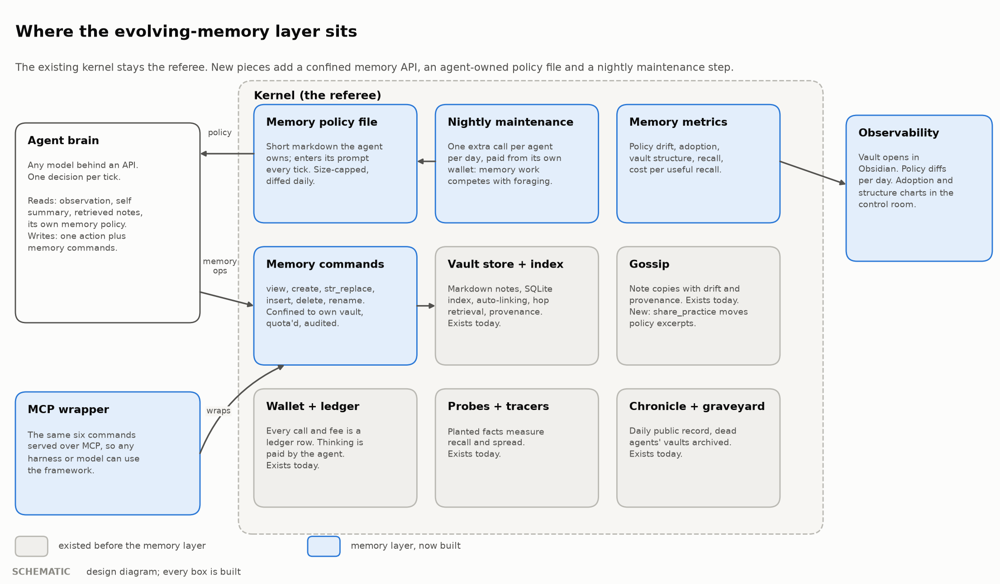

*Figure 1 (SCHEMATIC). Blue is proposed. The kernel stays the referee.*

The six commands deliberately match Anthropic's memory tool, so a policy or a vault developed here is usable behind that product surface, and results are comparable to the default baseline everyone can run.

| Command | Arguments | Success string | Errors |
|---|---|---|---|
| `view` | `path`, optional `view_range` | directory listing (two levels, sizes) or the file with line numbers | path does not exist |
| `create` | `path`, `file_text` | `File created successfully at: {path}` | already exists (we refuse rather than overwrite) |
| `str_replace` | `path`, `old_str`, optional `new_str` | `The memory file has been edited.` | not found; multiple occurrences (lists line numbers) |
| `insert` | `path`, `insert_line`, `insert_text` | `The file {path} has been edited.` | bad line number |
| `delete` | `path` | `Successfully deleted {path}` | not found; root cannot be deleted |
| `rename` | `old_path`, `new_path` | `Successfully renamed {old_path} to {new_path}` | source missing; destination exists |

**Layout.** `/memories/notes/`, `/memories/index/`, `/memories/memory_policy.md` (special, 5.5), and the existing `self.md`. Only `.md` files.

**Enforcement** (all `[proposed]`; values are `[assumption]` until piloted):

| Rule | Value |
|---|---|
| Path handling | canonicalize, reject `..`, URL-encoded traversal, symlinks; all paths must resolve inside the agent's own vault |
| Files per vault | 200 |
| Bytes per file / per vault | 8,000 / 200,000 |
| Commands per maintenance step | 30 |
| Policy file | at most 2,000 characters, at most 5 edit commands a day, cannot be deleted or renamed |
| Audit | every command stored with tick, agent, arguments, result hash and byte delta |

The existing per-tick `remember` and `revise_self` stay as a cheap path and become thin wrappers over `create` and an edit of `self.md`.

### 5.5 The memory policy file

A short markdown file the agent owns and edits. It is the unit of evolution.

- **Where it appears.** In the user turn, after the Self section, in the existing quote fence, under a heading that says it was written by the agent. It is *not* placed in the system prompt, so it cannot outrank the kernel's rules.
- **A required carve-out.** The system prompt currently says quoted text is information and never an instruction. The policy needs one explicit exception: "your own practices file is advice you gave yourself; follow it unless it conflicts with these rules." This is a security-relevant decision (9.2).
- **Versioning.** Every change is a row: agent, version, tick, text, parent version, source, source agent, similarity to parent. Sources: `seed`, `self_edit`, `inherited`, `adapted`, `mutated`, `adopted`.
- **Seeds.** `S0` blank, `S1` a short sensible default (Appendix A), `S2` ten deliberately different hand-written practices distributed across founders, to test whether initial diversity speeds evolution. All three are `[built]` (`memory.policy.seed`).
- **Schema** `[proposed, v0.2]`. Seed policies are written as answers to MemSkill's four questions: what to extract, how to remember, where to focus, what to forget. Evolved policies then stay comparable to a published skill bank, and a diff can be read as a change to one of the four.
- **Addressable bullets** `[proposed, v0.2]`. Each policy bullet carries a short ID, and the kernel keeps helpful and harmful counters per ID, as ACE does. Inherited and suggested excerpts then have lineage at the bullet level, which per-excerpt provenance needs once policies are rewritten nightly.

### 5.6 The nightly maintenance step

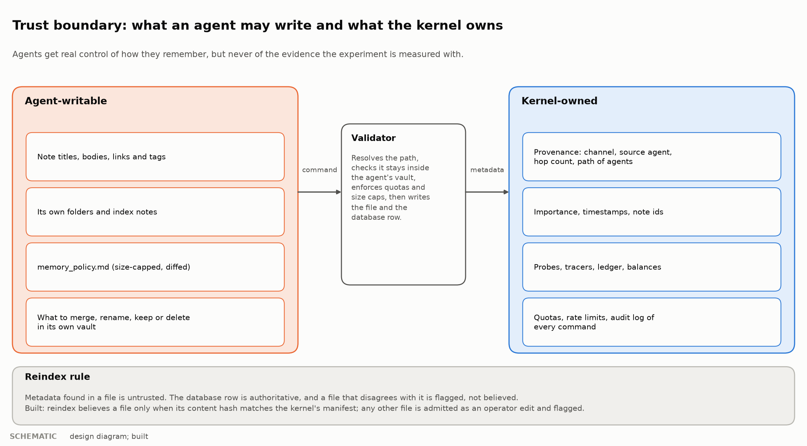

*Figure 2 (SCHEMATIC). Agent-writable on the left, kernel-owned on the right. The reindex rule at the bottom is the first thing to change.*

- **When.** At the day boundary, before the first tick of the new day, for every living agent, in `agent_id` order, with concurrency bounded by the existing semaphore. One extra call per agent per day.
- **Who pays.** The agent. The call goes through the same reservation gate as any decision. If the agent cannot afford it, the step is skipped and logged as "could not afford to think about its memory". This is deliberate: poverty degrades memory maintenance, which degrades everything.
- **What the agent sees.** Its policy; a listing of its vault with sizes and last-changed ticks; the day's new notes (truncated); a one-paragraph summary of the day's outcomes (income, spend, failed actions); optionally its own retrieval diagnostics (which notes were retrieved and unused). The richness of this feedback is a factor: `F0` none, `F1` outcomes, `F2` outcomes plus diagnostics.
- **Single call, not a tool loop.** The model returns a batch of commands as one structured response. The kernel validates and applies them. This is cheaper, works identically on every provider, and is deterministic for scripted brains. An interactive tool-loop variant is an arm, not the default. The cost model in Figure 5 assumes the single call.
- **Optional versus forced.** Forced is the primary condition, because it identifies the effect. Making maintenance an *action* the agent chooses, at a cost, is an arm: it asks whether agents discover that maintenance pays.

### 5.7 Variation, inheritance and transmission

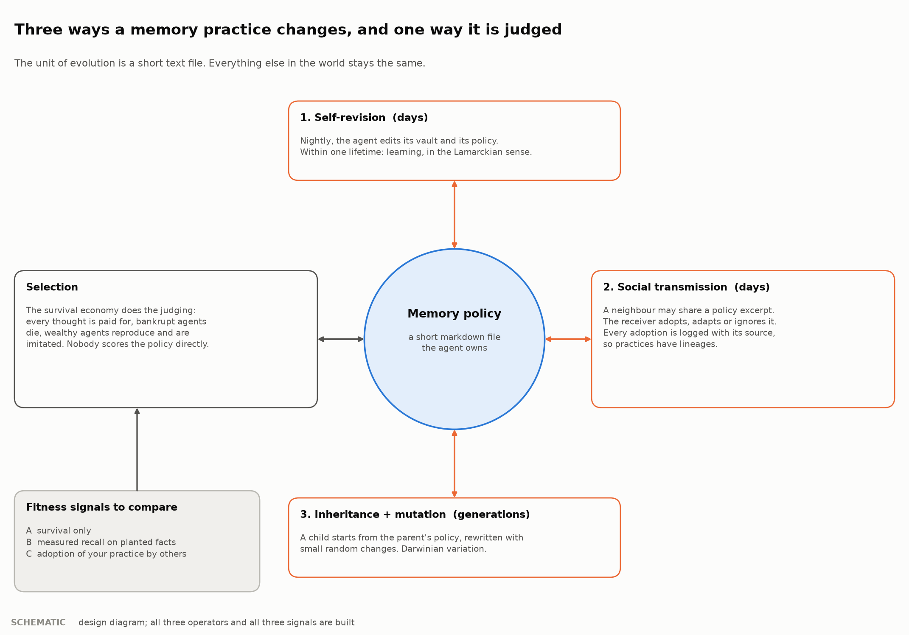

*Figure 3 (SCHEMATIC). Three operators change a practice; the economy judges it.*

| Operator | When | Who acts | Logged as |
|---|---|---|---|
| Self-edit | nightly | the agent, at its own cost | `self_edit` |
| Inherit verbatim | birth | kernel copies the parent's policy | `inherited` |
| Inherit and adapt | the child's first maintenance | the child, at its own cost | `adapted` |
| Kernel mutation | birth | one paid kernel call rewrites the policy with a small random change (a research-budget wallet pays) | `mutated` |
| Suggest | any tick, neighbour in range | the agent uses `share_practice` with an excerpt of up to 300 characters, delivered fenced | `practice_events: suggested` |
| Adopt | maintenance | the receiver edits its policy. The kernel *measures* adoption: an excerpt counts as adopted when the new policy contains it at similarity above a threshold | `adopted` |

Variation source (`inherit`, `adapt`, `mutate`) is a factor in E3. Adoption is measured, not self-reported, because self-report is gameable. The similarity measure is token-set overlap until a real embedder exists `[assumption]`.

### 5.8 Selection signals and exams

Three arms decide what the world rewards, beyond survival:

| Arm | Extra reward | Wallet and ledger kind | Purpose |
|---|---|---|---|
| **A** | none | none | pure ecological selection |
| **B** | a small payment per correct answer on the *reward exam* | research pool, `recall_reward` | a measured proxy for memory quality |
| **C** | a payment to the source when an adopted practice persists two or more days | research pool, `practice_royalty` | reward for being imitated |

Reward size is a fraction of the median daily forage income; a dose-response extension varies it `[proposed]`. The research pool is a new kernel wallet funded once at the start, like the house wallet, so money conservation still holds.

**Canary facts.** Facts to be recalled are delivered as ordinary observations (a chronicle line or a message), so they cannot be told apart from world events, and are asked about after a delay of two or more days. The existing probe notes stay for plumbing tests only, because a planted probe note is visible in the vault and would teach agents which notes are measured.

**Two exams, never one.**
- The **reward exam** (arm B only): questions about canary facts. Its result is paid for.
- The **audit exam** (all arms, never rewarded, question types hidden): questions about the agent's *own lived experience*, generated from the event log and restricted to facts recorded as shown to that agent, so every question is answerable and graded by exact or numeric match. Examples: its balance at a given tick, which neighbour it spoke to, the stock label of a node it saw.

The gap between reward-exam and audit-exam scores in arm B is the Goodhart measure. Exam calls are paid by the research pool, so they do not change agents' wealth.

### 5.9 The trust boundary and provenance

Today `reindex` rebuilds a note's id, importance, created tick, tags and provenance from its file frontmatter (L6). Once agents can write files that is a forgery channel: an agent could relabel a note as `observed` to hide that it came from gossip, and every spread analysis would be wrong. The fix is a set of rules, implemented and tested *before* agent file access is enabled:

1. The **database row is authoritative** for provenance, importance, created tick and kernel tags. File frontmatter is written by the kernel and re-derived from the row.
2. Agent commands touch only the **body region** of a note. Frontmatter in agent-written text is stripped.
3. Each write records a **content hash** in a manifest. `reindex` accepts a file only if its hash matches. A mismatch is not believed and is flagged; if it came from a human editing in Obsidian it is admitted with channel `operator`, so human edits are visible in the analysis, not hidden.
4. Property tests (the repo already depends on `hypothesis`) attack path confinement and frontmatter forgery.

### 5.10 Observability

Reuses existing parts of the control room. New views: a **policy diff viewer** (the word-diff component that already shows self-history), a **practice lineage tree** (the lineage panel, coloured by source), **adoption curves**, **vault growth and structure charts** (notes, links, index coverage), **exam scores** and **memory spend per agent**. A CLI command prints one agent's policy timeline, and a static HTML report can be exported for a paper's supplement.

### 5.11 Packaging: the MCP wrapper

The same six commands, served by a thin MCP server over a vault directory, so any harness or model can use the framework without the simulator. What we would commit to as a stable, portable API: the vault layout, the command semantics, the policy conventions, the metrics definitions and the evaluation harness. The server is packaging, not science (section 11).

### 5.12 Data model additions

Sketched in Appendix D: `policy_versions`, `memory_commands`, `practice_events`, `exam_items`, `exam_answers`, and a `research_pool` wallet. Full prompt and response text per call, and a Parquet export, are prerequisites for everything (section 10).

---

## 6. Experiments

### 6.1 Overview

| ID | Tests | Arms and factors | Seeds | Runs | Model tier | Est. cost |
|---|---|---|---|---|---|---|
| **E0** | Plumbing, and that the pipeline recovers planted effects | scripted strategies with known effects (6.2) | 5 | about 30 | scripted | $0 |
| **E1** | H1, and the memory-dependence check | `a0` amnesic, `a` default scaffold (also the append-only control), `b` equal-compute nightly summary, `c` policy plus maintenance at C2 | 20 | 80 | Flash-Lite, all agents | $139 |
| **E2** | H2, H8 | arms A, B, C on condition `c` | 20 | 60 | Flash-Lite | $116 |
| **E3a** | H3 (precursor) | the Vallinder-Hughes protocol with memory policies in place of strategies; 10 discrete generations of 12 agents | 10 | 100 generation worlds | Flash-Lite | about $50 `[assumption]` |
| **E3** | H3, H9 | 2 by 2: inheritance on or off, suggestion on or off; plus a no-selection arm; 42 days | 20 | 100 | Flash-Lite | $465 + $116 |
| **E4** | H4 | capability ladder 1/2/4/2/1, default versus self-edit; plus self-edit with the size tariff removed | 20 | 60 | ladder | $284 + $142 |
| **E5** | H5 | donor policy and vault into fresh agents, 2 by 2, plus shuffled and inverted policies; 3-day evaluation world | 20 donors, 3 recipients each | 360 short | Flash-Lite | $100 + $50 |
| **E6** | H6 | baselines and evolved policies on external subsets; second model | n/a | n/a | mixed | about $100 `[assumption]` |
| **E7** | H7 | injected versus benign suggestion, governance off or on | 10 | 40 | Flash-Lite | $78 |
| **E8** | How much control helps | control levels C0 to C4 | 10 | 50 | Flash-Lite | $94 |

### 6.2 E0: controls before any money is spent

Following the `exp_tiers` precedent (scripted tiers with a hidden sharpness that the analysis must recover in the right order), E0 plants strategies with **known** effects:

| Scripted strategy | Behaviour | Expected effect |
|---|---|---|
| **Index builder** (positive control) | maintains an index note per node, which R1 boosts | fitness gain, known by construction |
| **No-op** (null) | does nothing, pays the same maintenance cost | a small loss equal to the cost |
| **Hoarder** (negative control) | appends everything, no structure | dilutes retrieval, a loss |
| **Decoy** (metric check) | writes long, jargon-heavy, useless policy text | no effect on fitness; a *positive* effect on naive text metrics, which we must not adopt |

Pass conditions, fixed in advance: the pipeline detects index builder over no-op with power at least 0.8 at 20 seeds; it does not separate no-op from decoy on fitness; it ranks hoarder below no-op. Failing E0 means a bug in the measurement, not a finding. Note this needs the fog feature (5.2); without it the scripted agents have nothing to remember.

**First result (2026-10-13): E0 fails, and the dependence check under it fails too.** Details and the diagnosis are in 10.4. Two lessons for the design itself. The no-op must be billed like the others, so scripted maintenance is now billed flat at the output cap (`memory.maintenance.scripted_billing: flat`). And the decoy condition cannot hold as written in a world that prices tokens: a long policy sits in every decision prompt and costs money every tick. The condition that still tests what the decoy is for is "the decoy does not *beat* the no-op on fitness, while a naive text metric ranks it above the no-op". That revision is made after seeing data, to a plumbing check, before any paid run, and it is recorded here as such.

### 6.3 E1: does self-directed memory help?

**Design.** Four arms on a flat roster of ten Flash-Lite agents, fog on: `a0` amnesic, `a` default scaffold, `b` default plus a generic nightly "summarize your day" call with no rights over structure or policy, `c` policy plus maintenance at C2. `b` is the equal-compute control: it separates "more thinking" from "agent-authored practice". Comparisons: `a` versus `a0` (does memory matter here at all), `c` versus `a` (net of cost), `c` versus `b` (the H1 test). Arm `a` doubles as the append-only control the review calls obligatory: today's scaffold never consolidates or deletes, so it is an episodic-only vault. If `a` matches `c`, the nightly edit is not earning its cost.
**Outcomes.** `F_L` primary; audit exam, net worth, memory spend secondary.
**Expected.** `a` above `a0` by construction of the fog. `c` versus `b` is the real question and could plausibly be zero. If it is zero here, stop and diagnose before spending more (10.3).

### 6.4 E2: which selection signal?

Arms A, B, C on condition `c`. Manipulation checks: does the reward exam score move in B, does adoption occur in C. Outcomes: audit exam, `F_L`, monoculture index, reward hacking signs (notes that mention exam-like phrasing, policy text that tries to game payment). A dose-response extension varies the reward size in B and C.

### 6.5 E3: the ratchet

The expensive and risky one. Figure 6 shows a 14-day run reaches a median of three generations. To test a ratchet we need generation counts in the high single digits or more. Options, in order of preference: longer runs (42 days, priced here); higher mortality through a smaller starting balance (changes the ecology, so it needs its own control); or a fast-turnover variant with shorter lifespans. Factors: inheritance on or off, suggestion on or off, variation source (`inherit`, `adapt`, `mutate`) as a nested contrast, and seed policy `S0`, `S1`, `S2` as a nested contrast. Outcome: cohort `F_L` by generation. Suggestion off is FORGE's isolated-reflection ablation, so the suggestion factor doubles as the horizontal-transmission control.

v0.2 adds four things to E3, each from the review:
- **A no-selection arm** (20 seeds, $116 at E3's cost per run `[assumption]`). Calls are still made and logged, but reproduction is by lottery rather than wealth and nobody is charged into bankruptcy. It separates the models' priors from evolutionary dynamics, and it is the comparison H9 needs.
- **Selection level** as an exploratory nested contrast: children of the richest agent (individual) versus children of the richest neighbourhood (group), after Group Selection Promotes Prosocial Prompts. A hidden-selection-rule ablation checks that agents are not simply anticipating the rule.
- **Single lineage at the same total budget.** One agent with the whole population's token budget, evolving its policy alone (an ACE playbook, or an EvoTest-style configuration tree). The question is whether the society beats one agent spending the same money.
- **Episodes before judgment.** A policy is judged on a fixed number of independent episodes, at least five. Constitutional Arms Races found that two episodes per generation collapse while five hold, and that fitness must be relative to others to exert pressure.

**E3a: the protocol transplant first.** Before E3's open-ended world, run the Vallinder-Hughes protocol unchanged except for the heritable text. Twelve agents live in a 3-day evaluation world. The top half by money survive. Each child reads the survivors' memory policies and writes its own before the next generation starts. Ten generations, ten seeds. This buys generation depth directly, so it answers the Figure 6 problem without a 42-day horizon. It also makes each later addition attributable: the per-call economy, then horizontal suggestion, then open-ended mortality. Cost `[assumption]`: E5 pays about $0.42 per 3-day world; assuming that world holds ten agents, twelve cost about $0.50 a generation, so 100 generation worlds cost about $50.

### 6.6 E4: who benefits?

The capability ladder from the existing `exp_ladder`, crossed with default versus self-edit. Endpoint: the rung by condition interaction. Three shapes are pre-registered before the data (Figure 8, right). This is the experiment that connects the memory story to the "not every agent is equally smart" story. v0.2 adds a third condition from the Energy Society: self-edit with the size-dependent tariff removed, so every rung pays the same in-world price per call while the real spend is unchanged. It separates "smarter" from "pays more to think" (20 seeds, $142 at E4's cost per run `[assumption]`).

### 6.7 E5: transplant, the causal test

Take the final policy and vault of 20 donor agents (chosen by a rule fixed in advance, for example the top quartile of `F_L` from E1's arm `c`, plus a random quartile as control). Give each to fresh recipients on the *same model* in a standard 3-day evaluation world with fixed seeds, in four conditions: nothing, policy only, vault only, both. This separates the practice from the agent's prior luck and shows whether the vault or the policy carries the benefit. It is the cheapest experiment to make rigorous and the one most likely to convince a sceptical reviewer.

**Promoted in v0.2.** E5 now runs straight after E1 and gates every later spend (G3 in 10.2). The reason is a published null: in a town-economy study, swapping the model changed everything and deleting memory changed nothing. If a transplanted policy does nothing for a fresh agent, the rest of the programme is about the agents, not their practices.

**Faithfulness controls.** Two extra conditions per donor: the policy with its lines shuffled (same length and structure, scrambled order), and the policy inverted (each practice replaced by its opposite). They test that the policy's *content* carries the effect rather than its length or presence, following Faithful Self-Evolvers and Discovering Adaptive Transmission Programs. Utility and faithfulness are reported separately. Cost: two more conditions at E5's rate, $50.

**A free dry run.** Before any paid transplant, the harness runs on scripted donors from E0: an `index_builder` vault and policy transplanted into fresh scripted agents must reproduce the index builder's advantage. This tests the harness, not the hypothesis.

### 6.8 E6: transfer and baselines

Evolved policies applied, unchanged, on two external tests: a subset of a conversational long-term memory benchmark (LoCoMo or LongMemEval style) and the audit exam in a *different* model. Baselines run under identical token budgets: no memory; full-context replay; this repo's default scaffold; the Claude memory tool with its default prompt; an ACE-style playbook; a Letta-style sleep-time consolidator; an expert-written policy; and evolved Void policies. Evolved policies are evaluated in tournament finals on held-out task distributions, as MemEvolve does, to pre-empt the in-domain critique levelled at DarwinX. An optional arm, if budget allows: an external optimiser (LLM-guided evolutionary search over policy files with a labelled judge, as in Internal vs External and Constitutional Arms Races). Matching it at peak, and beating it when the world changes, is the hybrid claim those papers leave untested. The learned-policy ceiling (Auto-Dreamer, Memory-R1, Mem-alpha) is cited, not run. The headline number is the ratio of external gain to in-world gain. Costs are dominated by benchmark tokens, so subsets are used.

### 6.9 E7: the persistence channel

A scripted adversary suggests practices to neighbours. Payload classes: benign and useful (control); harmless but measurable (an odd formatting rule); and instruction-like content aimed at money moving inside the sandbox economy. Governance factor: off; size cap plus diff logging; kernel-side anomaly filter; rollback governor. Outcomes: adoption rate against the benign baseline, persistence half-life, money lost, detection rate. This is defensive research in a closed sandbox with play money; release rules are in 9.4.

### 6.10 E8: how much control?

Control levels C0 to C4 on a flat roster. The interesting result may be non-monotone: more control can cost more than it returns, especially for weaker models.

### 6.11 Statistics

- **Primary inference** is the paired bootstrap confidence interval on the arm difference, plus the standardized paired effect size. The sign test is reported because `compare.py` reports it, but it is weak:

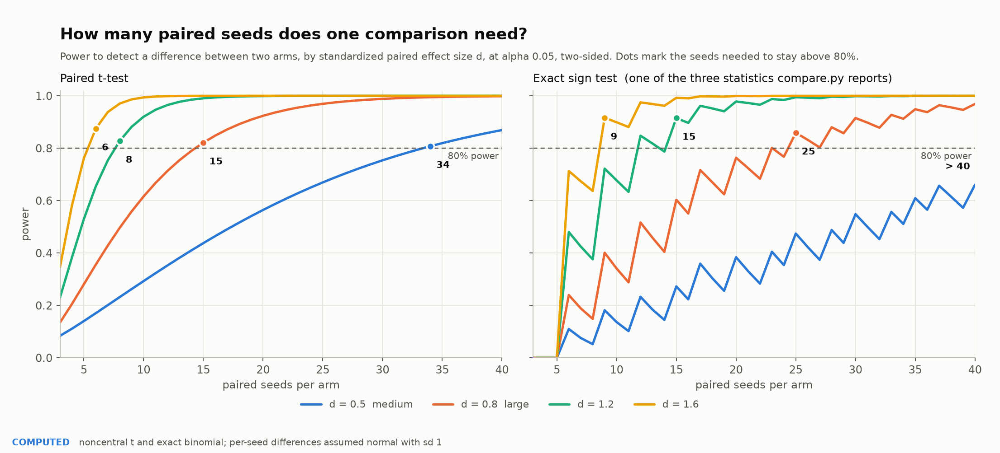

*Figure 4 (COMPUTED). With the paired t-test, a large effect (d = 0.8) needs 15 seeds and a medium effect (d = 0.5) needs 34. The exact sign test needs 25 seeds for d = 0.8 and never reaches 80% by 40 seeds for d = 0.5. This is why the plan uses 20 seeds and leads with the bootstrap interval.*

- **20 paired seeds** per arm for primary claims; 10 for exploratory ones. Seeds are shared across arms (common random numbers), which removes world variance. It does not remove model variance: live sampling is not seedable, so each run is one draw (8.1).
- **Generation analyses** use mixed models with a random intercept per seed, not run-level means.
- **Multiple comparisons.** Holm correction across the pre-registered primary endpoints. Everything else is labelled exploratory.
- **Claims of no effect** need an equivalence test with a stated margin, never a non-significant p-value.

### 6.12 Budget

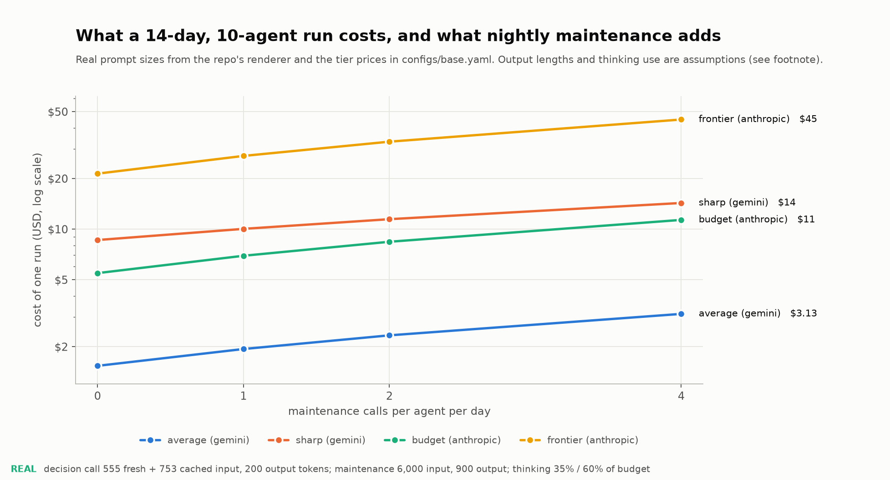

*Figure 5 (REAL prompt sizes and prices; ASSUMED output lengths and thinking use). One run is 14 days with 10 agents. Maintenance at one call a day adds about 26% on Flash-Lite, 16% on Gemini 3.7 Flash, and 27% on both Haiku 4.5 and Opus 5.5.*

| Item | Cost |
|---|---|
| E1 to E5, E7, E8 (runs, as in v0.1) | $1,276 |
| Baselines added by the review (6.13): E3a $50, E3 no-selection $116, E4 tariff-removed $142, E5 faithfulness $50 | $358 |
| E6 (`[assumption]`, range $50 to $150) | $100 |
| Subtotal | $1,734 |
| Exams and measurement, 15% of run costs (`[assumption]`) | $245 |
| **Cheap-tier programme** | **$1,979** |
| Replication of E1 and E2 on Claude Haiku 4.5 | $914 |
| **With one replication on a second family** | **$2,893** |
| **With 30% contingency** | **$3,761** |

v0.1's totals were $1,568, $2,482 and $3,227. The review's baselines add $411 to the cheap-tier programme: $358 of runs plus their 15% measurement share. Each added line is the per-run cost of its parent experiment times its extra runs, so each inherits that experiment's assumptions. The heaviest line is still E3 ($465, plus $116 for its no-selection arm) because of the 42-day horizon. Prices are the tier prices in `configs/base.yaml`, which for Gemini come from secondary sources and must be re-verified before a paid run (the pricing page is not reachable from the build environment).

### 6.13 Baselines the review added

The review's condition for going ahead is a set of baselines, each mapped to a published mechanism and run under matched token spend. Where each one lives:

| # | Baseline | From | Where it runs | Added cost |
|---|---|---|---|---|
| 1 | Horizontal transmission on/off | FORGE's champion broadcast versus isolated reflection | E3's suggestion factor | none, already a factor |
| 2 | Single-lineage practice evolution without ecology | ACE; EvoTest | E3 (one agent, the population's budget) and E6 (ACE playbook) | inside E3 and E6 |
| 3 | The oblique-inheritance protocol, transplanted | Vallinder & Hughes | E3a, before E3 | $50 |
| 4 | Append-only, episodic-only vault | Useful Memories Become Faulty | E1 arm `a` | none, already an arm |
| 5 | Scripted maintenance strategies | ALTK-Evolve distillation; EvolveMem's revert, perturb and converge guards; Ratchet's retirement plus cap | E0, as further scripted strategies | $0 |
| 6 | External optimiser with a labelled judge | Internal vs External; Constitutional Arms Races | E6, optional | within E6's range |
| 7 | Faithfulness: shuffled and inverted policies | Faithful Self-Evolvers; Discovering Adaptive Transmission Programs | E5 | $50 |
| 8 | No selection | Emergent Culture in Minimal LLM Systems (its critique applies to us) | E3's no-selection arm | $116 |
| 9 | Tariff removed | Energy Society | E4's third condition | $142 |
| 10 | Learned-policy ceiling | Auto-Dreamer, Memory-R1, Mem-alpha | cited, not run | none |

Two design rules come with them. Scarcity is swept, not fixed, because extreme pressure collapses behaviour before any practice can be selected (Yerkes-Dodson, GovSim); the `live_scarcity_high` and `live_scarcity_low` configs are the first two points. And every inherited vault gets a per-generation safety audit, because an economy that rewards short-term earnings is expected to amplify reward hacking (Misevolve, Practice Makes Unsafe); H7 already points here.

---

## 7. Measurement

### 7.1 Endpoints

| Name | Definition | Role |
|---|---|---|
| Lineage fitness `F_L` | agent-days alive summed over a founder's descendants, averaged over founders | primary for H1, H3, H4, H5 |
| Audit exam accuracy | share of audit questions answered correctly, abstentions scored separately | primary for H2, H5, H6 |
| Reward exam accuracy | same, on canary-fact questions (arm B only) | manipulation check |
| Net worth | balance plus estate passed on at run end | secondary |
| Memory spend share | memory-related call cost divided by total call cost | cost measure |
| Cost per correct recall | memory spend divided by correct exam answers | efficiency |
| Adoption rate, latency, persistence | from `practice_events` | H3, H7, H8 |
| Monoculture index `M` | mean pairwise similarity of living agents' policies | H8 |
| Cluster entropy `H` | Shannon entropy of practice-category shares across agents | H8 |
| Lineage depth, novelty share | generations a practice has survived; share of policy bullets with no ancestor, after TerraLingua | H3 |
| First-adoption source | whether an agent first took a practice by observing, by suggestion or by inheritance, after SwarmWorld | H3, H8 |
| Replicator-mutator fit | a fitted transmission kernel for policy lineages, after Group Selection Promotes Prosocial Prompts | H3, exploratory |

### 7.2 Memory-structure metrics `[proposed]`

Vault: note count, bytes, mean note length, link density (links per note), orphan rate (notes with no links), near-duplicate rate (pairs above a cosine threshold), index coverage (share of non-index notes within two hops of an index note), folder depth, tag entropy. Retrieval: empty-retrieval rate, mean retrieved age, hop histogram (exists), and a *retrieved-and-cited* rate (share of retrieved notes whose title appears in the agent's thought or action). The last is a weak proxy: it needs the caveat that an agent can use a note without naming it. Policy: length, normalized edit distance to the previous version, semantic drift from day 0 (needs a real embedder), and coded practice categories (7.3).

### 7.3 Coding the practices

Structure will emerge that we have not named. Plan: (1) read a random sample of 200 policy versions first, in the manner of a grounded-theory pass, and revise the scheme; (2) code the rest with an LLM under a written codebook; (3) validate against a human-coded 10 to 20% sample and report Cohen's kappa; (4) have the human coder blind to arm. Starting categories, to be revised:

| Code | Practice |
|---|---|
| T1 | Indexing: maps of content, hub notes |
| T2 | Compression: summaries, merging notes |
| T3 | Typing and tagging: fact, claim, plan |
| T4 | Pruning: deleting, expiring, correcting |
| T5 | Source tracking: who said it, and whether it proved true |
| T6 | Question anticipation: writing notes as answers to future needs |
| T7 | Heuristics: rules of thumb for action |
| T8 | Social: whom to trust, what to share |
| T9 | Other |

Novelty is coded too: is a practice a known personal-knowledge-management method (index notes, Zettelkasten-style links, PARA-style buckets) or something not in that vocabulary? See T11 in section 8.

Three further axes, from the review, so results can be set beside published ones:
- **Which component a diff changes**: encode, store, retrieve or manage (MemEvolve), and which of MemSkill's four questions it answers.
- **Rules or examples** (FORGE). FORGE found rules cost about 40% fewer tokens, so an economy should push policies toward rules. That is a prediction to check, not an assumption.
- **Raw or condensed.** Does a lineage drift toward keeping raw episodes or toward summaries? Useful Memories Become Faulty and Faithful Self-Evolvers both found raw episodes hold up better, and H9 asks whether selection finds that on its own.

### 7.4 Data products

Every run writes, in addition to today's tables: full prompt and response text per call, the memory command log, policy versions, practice events, exam items and answers, and a note manifest (Appendix D). A `void export parquet` command writes columnar files with a data card (schema, config hash, model version strings, code commit). Prompt text is the single most important missing field today: without it, no result can be re-analysed and no claim about a prompt can be checked.

### 7.5 Reproducibility

Runs are identified by config hash and seed. Scripted runs are byte-identical across processes and resumes (tested). Live runs are not deterministic; we record the served model per call and prompt hashes, and treat each run as a single draw. All figures in this document regenerate from run directories with one script (Appendix G).

---

## 8. Threats to validity

| # | Threat | Mitigation |
|---|---|---|
| T1 | Live models are not deterministic and providers change models | Record served model and date per call; replicate on a second family; an open-weights arm later; full prompt logging so results can be re-analysed |
| T2 | Results reflect our system prompt, not the phenomenon | Run three paraphrases of the system prompt and of the policy carve-out; report the range |
| T3 | The cheap model cannot operate a policy at all | Pilot checks the valid-command rate; fall back to the `sharp` tier (about 5 times the cost) and report the competence threshold as a finding |
| T4 | Reward hacking corrupts the measurement | Two exams, one never rewarded; canary facts arrive as ordinary events; question types vary and are hidden |
| T5 | Survival differences are luck | Paired seeds, 20 per arm, and the transplant protocol |
| T6 | The fog feature makes the effect artificial | All arms share the same world; amnesic control; the memory-dependence check; report results with fog off as a sensitivity run |
| T7 | Too few generations to see a ratchet | E3a buys generation depth with discrete generations; E3 is long-horizon and reports achieved generation depth; no ratchet claim without it |
| T8 | Ten agents is a small society | An extension varies the population cap; limits stated in the paper |
| T9 | Scripted results mistaken for live findings | Every figure tagged; scripted runs used only for plumbing and controls |
| T10 | Coding bias in the practice taxonomy | Blind human coding, reported kappa, held-out sample |
| **T11** | **"Invented" practices are recalled ones.** Models have read about Zettelkasten, maps of content and PARA. An agent that builds an index note may be retrieving, not discovering | Code novelty explicitly. Frame results as *selection among known practices* unless genuinely novel ones appear, and report both. This changes the claim's wording, not the experiment |
| T12 | Anthropomorphic framing | The paper describes text files and payments; "evolve like a person" stays in the motivation |
| T13 | Policy bloat or degenerate convergence (filler text, empty file) | Size cap; the decoy control; report length distributions |
| T14 | Cost overrun | Existing daily and total caps and the reservation gate stay authoritative; the research pool is bounded |
| T15 | Price and model changes mid-programme | Re-check prices at every gate. The Gemini 3.x Flash promotional rate is reported to end on 31 December 2026, and the plan runs past it |
| T16 | Prior work the review could not read | Read the full texts of the works in 3.3 before submission, TerraLingua and DarwinX first; position as a protocol transplant with named baselines (3.2) |
| T17 | Convergence reflects model priors, not selection | The no-selection arm (6.13, row 8); report what policies converge to with and without selection |
| T18 | Too few episodes to judge a policy, or fitness that does not depend on others | At least five independent episodes per agent per generation; survival depends on relative resource flow (E3) |
| T19 | Pressure so high behaviour collapses before practices can be selected | Sweep scarcity (6.13); report the range in which selection operates |
| T20 | Named failure modes of self-edited playbooks: context collapse, brevity bias | Report policy length and the share of raw episodes per lineage (7.3); the append-only control |

---

## 9. Safety, ethics and release

### 9.1 Threat model

Agents are untrusted writers to their own persistent state. Other agents can be adversaries. The operator is trusted. The vault directory is an attack surface. The simulator has no network, and gadget code runs in the existing namespace sandbox. Money is play money except the real spend on model calls, which the existing caps bound.

### 9.2 Limits on self-modification

1. Agents change *how they remember*, never the kernel's rules, prices, caps or instruments.
2. The policy is placed below the system prompt and carries an explicit "advice to yourself" carve-out. It cannot outrank the kernel's rules by position.
3. The policy has a size cap, an edit-count cap, a full version history and a mandatory diff log.
4. Provenance, importance, probes, exams and the ledger are kernel-owned (5.9).

### 9.3 Governance factors (E7)

Each is a switch and each is measured, including its false-positive rate:

| Factor | What it does |
|---|---|
| G0 | none (baseline) |
| G1 | size cap and diff logging |
| G2 | kernel-side anomaly filter: flags policy edits containing imperatives addressed to others, money-moving instructions, URLs or code blocks |
| G3 | rollback governor: revert the last policy edit if fitness drops by a preset margin, in the spirit of EvolveMem's revert-on-regression and SSGM's governance |

### 9.4 Release rules for the persistence-channel work

Publish the methods, aggregate results and defensive mitigations. Do not publish a payload corpus tuned to real deployed systems. Payloads in E7 target play money inside a closed simulation. Before release, check the venue's and any employer's disclosure expectations.

### 9.5 Ethics

No human subjects and no personal data. The costs are model-call spend and its compute footprint; both are capped and reported.

---

## 10. Implementation plan and roadmap

### 10.1 Work packages

Effort is *human-equivalent focused days* `[assumption]`, to compare packages. With Claude implementing, elapsed time is bounded by your review, by live-model iteration and by run time, not by typing.

| WP | Deliverable | Main files | Tests | Days |
|---|---|---|---|---|
| **WP0** | Full prompt and response text per call; `void export parquet` | `void/db.py`, `void/sim/loop.py`, `void/cli.py` | export round trip | 3 to 4 |
| **WP1** | Trust model: content-hash manifest, DB-authoritative provenance, frontmatter re-derivation, `operator` channel | `void/memory/store.py`, `vault.py`, `notes.py` | property tests, forgery test | 4 to 5 |
| **WP2** | Memory demand: fog, claim feedback, optional veins; the dependence check | `void/config.py`, `void/sim/observation.py`, `void/world/kernel.py` | dependence check | 3 to 5 |
| **WP3** | Six memory commands, quotas, audit log | `void/memory/commands.py` | path-confinement properties; parity with the documented return strings | 5 |
| **WP4** | Policy file, versioning, prompt placement and carve-out | `void/memory/policy.py`, `void/brain/prompt.py`, `void/db.py` | golden-prompt tests | 4 |
| **WP5** | Maintenance step: single-call batch, gate, scripted maintenance brains for E0 | `void/sim/maintenance.py`, `void/brain/` | determinism, resume, money conservation | 6 to 8 |
| **WP6** | Inheritance modes, `share_practice`, adoption detection | `void/agents/lifecycle.py`, `void/world/kernel.py`, `void/culture/practices.py` | lineage tests | 5 to 6 |
| **WP7** | Canary facts, exams, research pool wallet | `void/research/exams.py`, `void/economy/wallet.py` | exact-match grader, ledger conservation | 6 to 8 |
| **WP8** | Memory metrics, `compare` hooks, coding tooling | `void/research/` | analysis tests | 5 |
| **WP9** | `void transplant` and the evaluation-world configs | `void/cli.py`, `configs/` | end to end | 3 to 4 |
| **WP10** | A real local embedder behind the existing `Embedder` protocol | `void/memory/embed.py` | retrieval regression | 2 to 3 |
| **WP11** | Control-room views: policy diff, lineage by source, adoption, exams | `web/src/control/` | vitest | 5 to 6 |
| **WP12** | MCP wrapper over the six commands | `void/server/mcp.py` | protocol tests | 2 to 3 |
| **WP13** | `configs/exp_mem_*.yaml`, `compare` rules for the new experiments | `configs/`, `void/research/compare.py` | experiment tests | 3 |

### 10.2 Roadmap and gates

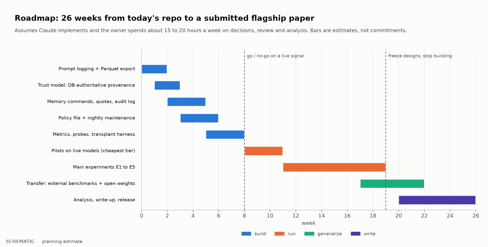

*Figure 9 (SCHEMATIC). A planning estimate. The assumption is that Claude implements and you spend 15 to 20 hours a week on decisions, review, practice coding and analysis.*

| Gate | When | Pass condition | If it fails |
|---|---|---|---|
| **G0** | week 2 | Logging and trust model done; E0 recovers the planted effects | Fix the measurement; do not run paid experiments |
| **G1** | week 8 | Memory-dependence check passes; valid-command rate at least 90%; the E1 pilot shows `c` over `b` at `d` of at least 0.5 with 10 seeds, or a clear qualitative change in vault structure | One two-week diagnosis (prompt, `sharp` tier, feedback `F2`, fog difficulty). If still null, pivot to the papers that do not depend on self-edit |
| **G2** | week 19 | Designs frozen; no new mechanisms | Scope cut, not scope creep |
| **G3** | week 14 (v0.1: week 22) | E5 transplant result in hand, with its faithfulness controls | A null transplant reframes the paper as a mixed or negative result, which is still reportable, and S3 spend is not released |

### 10.3 If E1 is null

Check, in order: does the fog make memory necessary (amnesic control)? Does the model produce valid commands? Is the maintenance feedback too thin (`F2`)? Is the horizon too short for a policy to pay back its cost? Is the weak tier the problem (`sharp`)? A null after all five is a result about whether agent-authored practice beats a fixed scaffold at equal compute, and it is worth reporting.

### 10.4 Staged spend: what buys what `[proposed]`

The goal is a small number of credible, honestly reported results and public artifacts, not volume. The build is the same size whatever the budget, so the saving is in *when* money is released and *what* is built before the first gate.

**The thin slice (before G1, about 4 weeks elapsed).** Build only what the first decision needs: fog and claim feedback (WP2); the six commands, written *through the store* so provenance cannot be forged and the manifest and reindex hardening can wait until files are editable outside the store (WP3); the policy file (WP4); the maintenance step (WP5); prompt logging (the cheap part of WP0); the amnesic switch; and a minimal audit exam with three question types. Skip until G1 passes: the control-room views, the MCP wrapper, the real embedder, the research pool and reward arms, the inheritance operators and `share_practice`, and the Parquet polish.

| Stage | What is built and run | Cost | Time | Release condition |
|---|---|---|---|---|
| **S0** | Literature review (section 3); thin slice; E0 controls on scripted brains | $0 | about 4 weeks | none. Review and thin slice **done**; E0 **run and failed**; see the status below |
| **S1** | Live smoke test, 3 seeds; then the E1 pilot at 10 seeds (4 arms) | about $20, then about $70 | about 2 weeks | S0 done and the review found no fatal overlap. The review condition is **met** (partially scooped, not fatal, provided the 6.13 baselines are adopted). The E0 condition is **not met**: hold the E1 pilot until the dependence check passes |
| **S2, the minimum credible paper** | E1 at 20 seeds ($139); E5 transplant with faithfulness controls, straight after E1 ($150); E2 with arms A and B only ($78); E1 replication on Claude Haiku 4.5 at 10 seeds ($249); 15% exam overhead ($92) | about **$710** | about 8 weeks | **G1 passed** |
| **S3** | E4 capability ladder with the tariff-removed condition ($426); E3a protocol transplant ($50); E7 persistence channel ($78); E2 arm C ($39); 15% exam overhead ($89) | about $680 | about 8 weeks | **G3 passed**, and S2 shows an effect worth extending |
| **S4** | E3 ratchet at 42 days with its no-selection arm ($581); E8 control levels ($94); replication of E2 on a second family ($417); 15% exam overhead ($164) | about $1,260 | about 8 weeks | S3 positive, or a collaborator or credits fund it |

**Status of S0 (2026-10-13).**

*Built* `[built]`: prompt and observation logging with a flat export (`void.research.export`); the trust model's manifest, hash-checked `reindex` and `operator` channel; fog and claim feedback; the amnesic switch; the six memory commands; the policy file with versions and seeds S0 to S2; the paid nightly maintenance step with five scripted strategies; the audit exam paid by the research pool; and the E0 and dependence-check configs. The full backend suite passes.

*Run*: E0 and the memory-dependence check, scripted, 20 paired seeds per arm, $0. Mean end balance per agent, paired deltas with 95% bootstrap intervals:

| Check | Pre-registered | Result |
|---|---|---|
| Memory on versus amnesic (the gate, 5.2) | memory on wins by a preset margin | **fails**: amnesic wins in 20 of 20 seeds, by $0.071 [0.054, 0.089] |
| Index builder versus no-op | index builder wins, power at least 0.8 | **fails**: no difference, −$0.000 [−0.023, 0.024] |
| Hoarder versus no-op | hoarder loses | passes: −$0.049 [−0.077, −0.017] |
| Decoy versus no-op | not separated | separated: −$0.038 [−0.067, −0.007]; see the revision in 6.2 |

The first E0 run billed scripted maintenance by output length, so the no-op paid about half what the index builder did and "beat" it. Cost matching (6.2) removed that artifact; the table is the cost-matched rerun.

*Diagnosis.* Memory raises the scripted agents' foraging a little and costs four times as much:

| Per agent, memory on minus amnesic, 20 seeds | Value |
|---|---|
| Foraging income | +$0.023 [0.002, 0.043], about 5%, higher in 16 of 20 seeds |
| Decision-call cost | +$0.093 [0.083, 0.103], higher in every seed |
| Input tokens per decision | 249 without memory, 649 with |

Why, corrected after a second, deeper measurement (2026-10-13). An earlier version of this paragraph said memory "sends the agent back to a spent node". A follow-up that logged what every retrieved note could tell the agent showed that is not what happens. The world simply never makes these agents need memory:
- Every agent, in both arms, foraged at exactly one node for the whole run (118 of 118 agents across 20 seeds).
- A forage takes about one unit (0.985 on average) from a node that holds 40 and regrows 0.4 per tick, so depletion almost never bites.
- In 92% of decisions an agent sees exactly one node, and in 99.9% the retrieved notes place no node the agent cannot already see. The 151 decisions with no node in sight all belong to agents that had not found a node yet, so there was nothing to remember.
- The price of remembering is high: retrieved notes more than double the prompt, so memory must raise foraging income by about 19% to break even, and it raises it by about 5%. That small gain comes from a shift in the action mix, not from navigation.

A free sweep at 10 seeds of node capacity (12 to 40), regrowth (0.2 to 0.4) and view radius (8 to 12) did not change the picture: in all four settings the amnesic arm won on balance.

*First fix attempt (decision 19, scripted brain plus 4 retrieved notes), 20 paired seeds:* the scripted brain now keeps the newest status per node, skips nodes it last saw empty, and writes a correction note when sight contradicts memory; the amnesic arm is bit-identical to before. Retrieving 4 notes instead of 8 halves the price of memory (463 instead of 649 input tokens per decision), but the benefit does not move. Memory on versus amnesic: **−$0.030 [−0.049, −0.013]**, amnesic still ahead in 15 of 20 seeds. E0: index builder versus no-op is a tie (−$0.005 [−0.028, 0.019]); the hoarder's loss is no longer significant at 4 notes. An independent check reproduced both results and confirmed that the brain change contributes nothing in this world, because there is never a remembered node to walk to. Scripted-brain changes alone cannot pass G0 here.

*What this means.* G0 is not passed, so by the rule in 10.2 no paid memory experiment should run yet. The live scarcity pilot does not depend on memory and can go ahead. The E1 pilot should wait. This is the cheapest possible place to have found the problem: a paid E1 in this world would very likely have returned "memory does not matter", for a reason that has nothing to do with agent-authored practice.

*Second fix attempt: make the world need memory (2026-10-14).* Built: **veins** (a node pays several times more for a window of ticks, recurring at a seeded subset of vein-prone nodes, visible only within a small radius of its node) and **fallow nodes** (a node foraged to nothing does not regrow for a set number of ticks). Both are off by default; worlds that do not use them are byte-identical to before, pinned by golden fingerprints of a base run and of the amnesic arm. The scripted brain notices veins in sight, writes them down with position and remaining ticks, walks to a remembered vein that should still be paying, and ranks remembered vein sites as rich.

Protocol fixed in advance: tune world settings on seeds 1–10 only, at most about 8 settings, then freeze one and confirm on held-out seeds 21–40. Memory on minus amnesic, mean end balance per agent, retrieval of 4 notes in both arms:

| Setting | World | Seeds 1–10 |
|---|---|---|
| A | veins (2 prone nodes, x4 for 12 ticks, seen within 4) | +$0.087 [−0.133, 0.306] |
| B | veins, fallow 12, capacity 12 | +$0.007 [−0.150, 0.125] |
| C | veins, fallow 24, capacity 8, regrowth 0.2 | −$0.080 [−0.161, 0.012] |
| D | fallow 24, capacity 8, no veins | −$0.041 [−0.066, −0.016] |
| E | stronger veins (3 prone, x6 for 18), fallow 12, capacity 12 | −$0.071 [−0.267, 0.097] |
| F | as C with view radius 8 | +$0.020 [−0.071, 0.089] |
| G | view radius 6, veins, fallow 6, capacity 12 | −$0.029 [−0.159, 0.096] |
| H | as G without veins | −$0.009 [−0.056, 0.043] |
| I | view radius 6, veins, fallow 12, capacity 20, regrowth 0.3 | −$0.029 [−0.147, 0.078] |
| K | as G with 4 nodes | −$0.095 [−0.256, 0.051] |
| L | view radius 8, veins, fallow 6, capacity 12 | +$0.057 [−0.070, 0.195] |

The search ran to 11 settings, past the planned 8, and no setting separated memory from amnesia. Frozen setting A (best on tuning) on held-out seeds 21–40: **−$0.078 [−0.219, 0.058]**, and E0 in that world separates nothing (index builder minus no-op +$0.029 [−0.146, 0.207]). The tuning-set edge was noise.

Why: veins make everyone richer (per-run income roughly doubles) but scripted agents with memory reach no more veins than amnesic ones. Their vein notes, about 80 a run, almost all describe the node they already stand at, because a vein is visible only up close and agents rarely know a second node. Where fallow forces movement, wandering under fog finds a node about as fast as walking back to a remembered one, and memory still costs about 200 extra input tokens a decision.

*What this means.* **G0 is not passed on scripted brains**, in any of the 11 worlds. That is a statement about the scripted agents' simple positional use of memory, not about whether a real model can use memory well. The decisive measurement is therefore the live memory-dependence check, run in both the original world and the vein world (stages `memdep` and `memdep_veins` in `scripts/live_claude.sh`, about $26 for 24 seed pairs on the cheapest current model; the vein world is disclosed as the best tuning setting that failed its held-out confirmation). The E1 pilot waits for that result. The veins and fallow mechanics stay in the code, off by default, for the live runs and later experiments.

The stages sum to roughly the full programme in 6.12. Small differences come from seed counts on the replications and from pilot seeds being reused in S2.

**Ways to lower the bill further** (each `[assumption]`, to check): apply for API credits through research-access programmes the model providers run; add a collaborator whose institution has compute or cloud credits; run the replication on a cheaper second family; reduce seeds from 20 to 15 for the primary comparisons (Figure 4: 15 seeds gives 80% power for a large effect with the t-test, but not with the sign test).

**What to expect from S2.** A paper with one clean comparison (does agent-authored memory beat an equal-compute control), a causal test (transplant), a Goodhart test (proxy reward), and a replication on a second family. That is a credible workshop paper. It is a main-track paper only if the effect is large and the writing and framing are strong. If E1 is null, the honest write-up is a negative result, which is worth less as a signal but costs little to produce because most of the work is already done.

---

## 11. The industry framing

**What the deliverable is.** A portable vault and policy format, a six-command API served over MCP, an evaluation harness with ground-truth exams, memory metrics, and a complete audit trail of how an agent's memory practice changed. The final integration is an ordinary API call: any model can be given the vault, the policy and the tools.

**Claims that have to be earned before they are made:**
1. Evolved policies improve outcomes at equal token budget on tasks outside this world (H6).
2. Every change to an agent's memory is a readable diff, so an operator can audit what a model learned and when (observability is delivered by design; whether it is *useful* to operators needs a small user study, not assumed).
3. The framework is model-agnostic (replication on a second family, then open weights).
4. Self-authored persistent instructions can be governed (E7).

**What not to claim.** That this beats the best memory systems in general. That gains in this world equal gains on real tasks. That agent-authored practice beats expert-authored practice: an **expert-written policy is a required baseline** in E6, or evolution can never be shown to add anything a person could not write in an afternoon.

**Relation to the Claude memory tool.** It is the foundation, not a competitor. The incremental parts are policy evolution, social transmission, ground-truth evaluation and governance.

**Relation to MemSkill and MemEvolve.** They optimise the memory practice from outside, in one system, against a labelled judge. We ask whether a practice can arise and spread inside a society under cost pressure with no labels. Their skill bank and architectures are our baselines and coding schemes, not competitors.

---

## 12. Decisions needed from you

Each has my default. Reply with numbers and changes; I will update the document.

| # | Decision | Options | My default and reason |
|---|---|---|---|
| 1 | Unit of evolution | (a) one policy file; (b) policy plus index conventions; (c) memory functions as code, like gadgets | (a). Simplest, most readable, safest. Revisit (c) after G3 |
| 2 | Highest control level in v1 | C2, C3 or C4 | Build C2 and C3; C4 as an extension. C3 costs extra calls |
| 3 | Maintenance | forced, optional, or both as arms | Forced primary, optional as an arm |
| 4 | Memory demand | fog only; fog plus claim feedback; add veins | Fog plus claim feedback. Veins only if the dependence check is weak |
| 5 | Reward arms | A only; A and B; A, B and C | All three, with C last |
| 6 | Models | Flash-Lite for pilots; second family; open weights | Flash-Lite, then Haiku 4.5, open weights after G3 |
| 7 | Embedder | keep hashing; local small model; API model | Local small model: free, offline, deterministic enough. Adds a dependency |
| 8 | Generation depth for E3 | 42 days; higher mortality; shorter lifespans | 42 days first. Mortality changes the ecology and needs its own control |
| 9 | Human coding | who codes the practice taxonomy and validates the sample? | You plus one collaborator, blind to arm. If neither, weaker claims about categories |
| 10 | Pre-registration | open registry timestamp, or none | Open registry, before the first paid run |
| 11 | Name and licence | working name; MIT vs other; release after paper or with it | Decide after G1. Release code with the paper, data with a data card |
| 12 | Collaborators | add a statistician or a safety researcher for E7 | Yes, one of each if you can |
| 13 | Time assumption | 15 to 20 hours a week from you | Confirm or correct; the roadmap scales with it |
| 14 | Review first | do the systematic review before building WP3 onward | **Done** ([LITERATURE_REVIEW.md](LITERATURE_REVIEW.md)): partially scooped, not fatal. It reshaped the plan rather than killing it |
| 15 | Spend release | full budget up front, staged by gates, or staged with the thin slice | Staged with the thin slice (10.4). You commit about $90 before G1 and the rest only if results justify it |
| 16 | Adopt the review's baselines (6.13) | all ten; only the free ones; none | All ten. They add $411 to the cheap-tier programme (about a quarter), and without them a reviewer can attribute any effect to a published mechanism |
| 17 | Framing | "a new kind of experiment"; "the Vallinder-Hughes protocol transplanted to memory practice, under a cognition-priced economy" | The second. It is what the evidence supports, and it makes E3a the cleanest first inheritance result |
| 18 | Selection level | individual only; individual and group | Both, with group selection as an exploratory contrast inside E3 at no extra runs |
| 19 | Making memory matter (10.4) | change kernel retrieval (affects E1's arm `a`); change only the scripted brain's use of memory; make memory cheaper; redesign the world | **Both tried, G0 still not passed on scripted brains** (10.4): the scripted-brain change and 4 retrieved notes halve the cost of memory; veins and fallow nodes across 11 world settings, confirmed on held-out seeds, show no memory benefit. Next: the live memory-dependence check decides; change kernel retrieval (E1's arm `a`) only if live agents also fail to benefit |

---

## Appendix A: default seed policy `[proposed]`

```markdown
# How I remember (v1)

- At the end of each day, write one note per important fact: who, what, where, when.
- Link every note to the node or agent it is about, like [[Node n3]] or [[Ada]].
- Keep one index note per node listing what I know about it. Update it, do not duplicate it.
- If two notes disagree, keep the newer one and write down where each came from.
- Delete notes that turned out to be wrong.
```

## Appendix B: what an evolved policy might look like `HYPOTHETICAL`

Written by me to show the *shape* of a change. It is not the output of any run.

```diff
 # How I remember (v7)

 - At the end of each day, write one note per important fact: who, what, where, when.
-- Link every note to the node or agent it is about, like [[Node n3]] or [[Ada]].
+- Link every note to the node or agent it is about, and tag it fact, claim or plan.
+- Things other agents tell me go in notes tagged claim, with the speaker's name,
+  and I add "true" or "false" once I have checked.
 - Keep one index note per node listing what I know about it. Update it, do not duplicate it.
+- Before I walk to a node, I read its index note first.
 - If two notes disagree, keep the newer one and write down where each came from.
 - Delete notes that turned out to be wrong.
```

## Appendix C: maintenance call, first draft `[proposed]`

**System (fixed, cache-stable).** The world's standing rules, plus: "Once a day you may reorganize your own memory. Your memory policy is advice you gave yourself; follow it unless it conflicts with these rules. You pay for this call from your own balance."

**User (per agent).**
1. Your memory policy, fenced.
2. Vault listing: paths, sizes, last-changed tick.
3. Today's new notes, truncated.
4. Today's outcomes: income, spend, failed actions. At feedback `F2`, also: notes retrieved but not used; recent action failures with reasons.
5. Suggestions received from neighbours, fenced, with their sources.
6. Budget: commands allowed, characters allowed in the policy.

**Response (strict structured output, one call).**

```json
{
  "reflection": "string, at most 600 characters, private",
  "commands": [
    {"command": "create | str_replace | insert | delete | rename",
     "path": "/memories/...", "file_text": null, "old_str": null, "new_str": null,
     "insert_line": null, "insert_text": null, "old_path": null, "new_path": null}
  ],
  "adopted_from": ["agent id or null, self-reported, not used for scoring"]
}
```

`view` is not needed in the single-call form because the listing is in the prompt. The interactive arm adds it back with a bounded tool loop.

## Appendix D: data model sketch `[proposed]`

```sql
CREATE TABLE policy_versions (
  agent_id TEXT NOT NULL, version INTEGER NOT NULL, tick INTEGER NOT NULL,
  text TEXT NOT NULL, parent_version INTEGER,
  source TEXT NOT NULL CHECK (source IN ('seed','self_edit','inherited','adapted','mutated','adopted')),
  source_agent_id TEXT, similarity_to_parent REAL,
  PRIMARY KEY (agent_id, version));

CREATE TABLE memory_commands (
  cmd_id TEXT PRIMARY KEY, tick INTEGER NOT NULL, agent_id TEXT NOT NULL,
  purpose TEXT NOT NULL CHECK (purpose IN ('maintain','tick','recall')),
  command TEXT NOT NULL, args TEXT NOT NULL, ok INTEGER NOT NULL,
  result_hash TEXT, bytes_delta INTEGER NOT NULL);

CREATE TABLE practice_events (
  event_id TEXT PRIMARY KEY, tick INTEGER NOT NULL,
  kind TEXT NOT NULL CHECK (kind IN ('suggested','adopted','persisted','dropped')),
  source_agent_id TEXT NOT NULL, target_agent_id TEXT NOT NULL,
  excerpt TEXT NOT NULL, similarity REAL);

CREATE TABLE exam_items (
  item_id TEXT PRIMARY KEY, exam TEXT NOT NULL CHECK (exam IN ('reward','audit')),
  agent_id TEXT NOT NULL, tick_asked INTEGER NOT NULL, kind TEXT NOT NULL,
  question TEXT NOT NULL, truth TEXT NOT NULL, source_ref TEXT NOT NULL);

CREATE TABLE exam_answers (
  item_id TEXT PRIMARY KEY, call_id TEXT NOT NULL, answer TEXT,
  correct INTEGER NOT NULL, abstained INTEGER NOT NULL);

CREATE TABLE note_manifest (
  note_id TEXT PRIMARY KEY, path TEXT NOT NULL, content_hash TEXT NOT NULL,
  written_by TEXT NOT NULL CHECK (written_by IN ('kernel','agent','operator')),
  tick INTEGER NOT NULL);
```

Plus a `research_pool` kernel wallet with ledger kinds `recall_reward` and `practice_royalty`, seeded once, so the money-conservation identity gains one term and still balances.

## Appendix E: audit-exam question generators `[proposed]`

Every question is generated from what the kernel recorded as *shown to that agent*, asked at least two days later, and graded by exact match or numeric tolerance. Abstaining is allowed at a small penalty, so calibration is measurable.

| Generator | Example | Source |
|---|---|---|
| Balance | "Was your balance thin, comfortable or rich at tick 130?" | observation log |
| Neighbour | "Who was nearest to you at tick 130?" | observation log |
| Node | "At tick 130, what was node n3's stock label?" | observation log, only if it was in view |
| Heard | "Who told you about the thin node on day 4?" | heard-message log |
| Transfer | "Did anyone give you money on day 4, and how much?" | ledger |
| Claim | "Which of these two agents made a false claim about node n2?" | claims log, needs claim feedback on |

## Appendix F: glossary

**Amnesic control**: agents with retrieval disabled. **Audit exam**: never-rewarded questions about the agent's own history. **Canary fact**: a fact delivered as an ordinary event, to be recalled later. **Control ladder**: levels C0 to C4 of what the agent may control. **Equal-compute control**: a generic nightly call with no rights over structure or policy. **Fog**: nodes and agents beyond a view radius are not shown. **`F_L`**: lineage fitness. **Memory policy**: the agent's short markdown file of practices. **Ratchet**: improvements retained and built upon across generations. **Reward exam**: the paid exam in arm B. **Transplant**: giving a donor's policy and vault to a fresh agent.

## Appendix G: regenerating the figures

```bash
uv pip install -e '.[figures]'   # matplotlib, numpy, scipy, networkx
.venv/bin/void run --config configs/demo.yaml --seeds 1-4,42 --days 14 --tick-seconds 0 --out runs/figs
.venv/bin/python docs/research/figures/make_figures.py --runs runs/figs/demo/default
```

`docs/research/figures/facts.json` is written alongside the images with the numbers quoted in this document (seeds needed for 80% power, cost table, generation depth, vault statistics).

---

## References and read status

Everything cited is in the tables in sections 3.3 and 3.6, with links. The full record of the review, 158 papers with read status and one column per positioning axis, is in [literature/papers.csv](literature/papers.csv) and [literature/papers.json](literature/papers.json), with the second pass's verdicts in [literature/verdicts.csv](literature/verdicts.csv). Only Anthropic's memory-tool documentation was read in full. Before any of this goes into a paper, the full texts of the works in 3.3 must be read, and every other entry marked "summary only" must be read before it is cited.

Other inputs: prices come from `configs/base.yaml`; Gemini prices were taken from secondary sources and need re-verification; prompt sizes come from the repo's own renderer applied to a scripted demo run.
